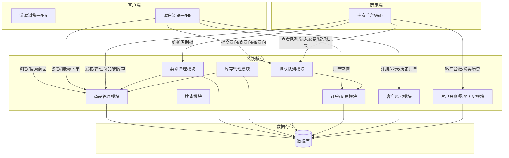
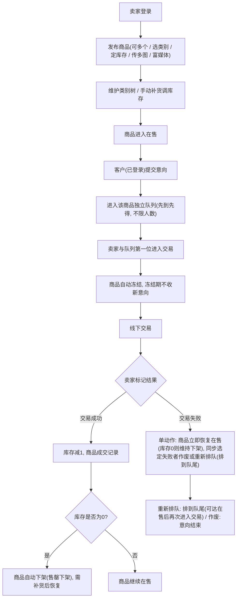
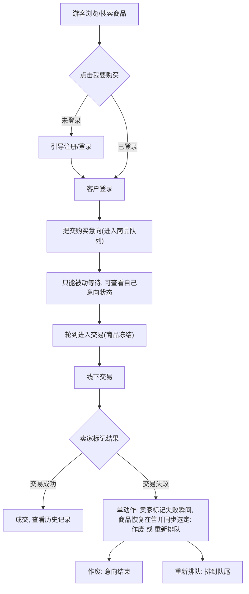
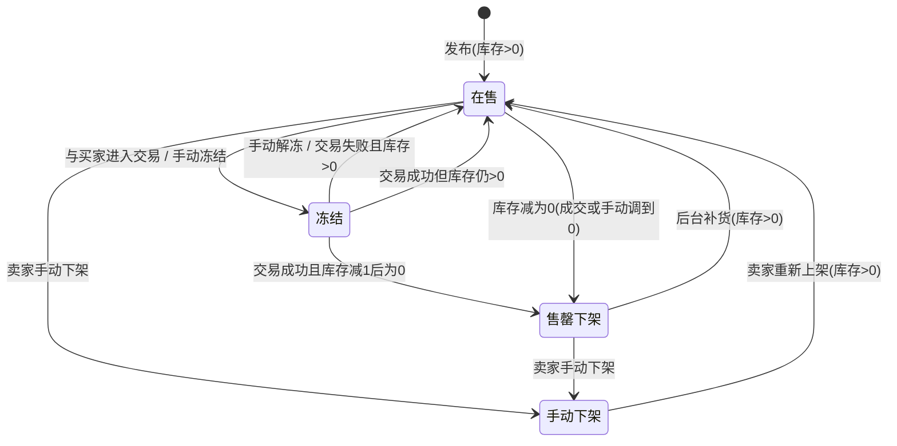
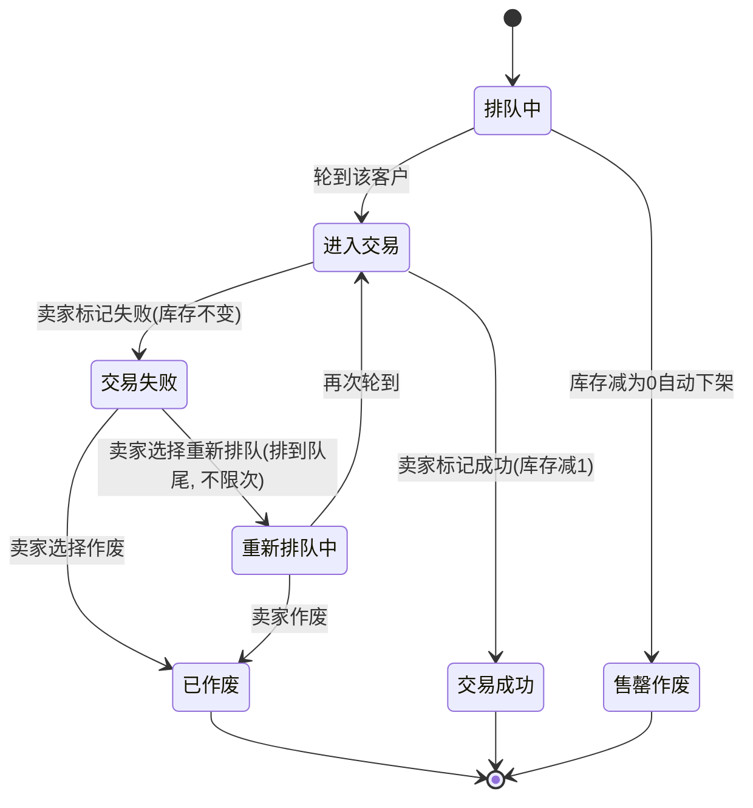
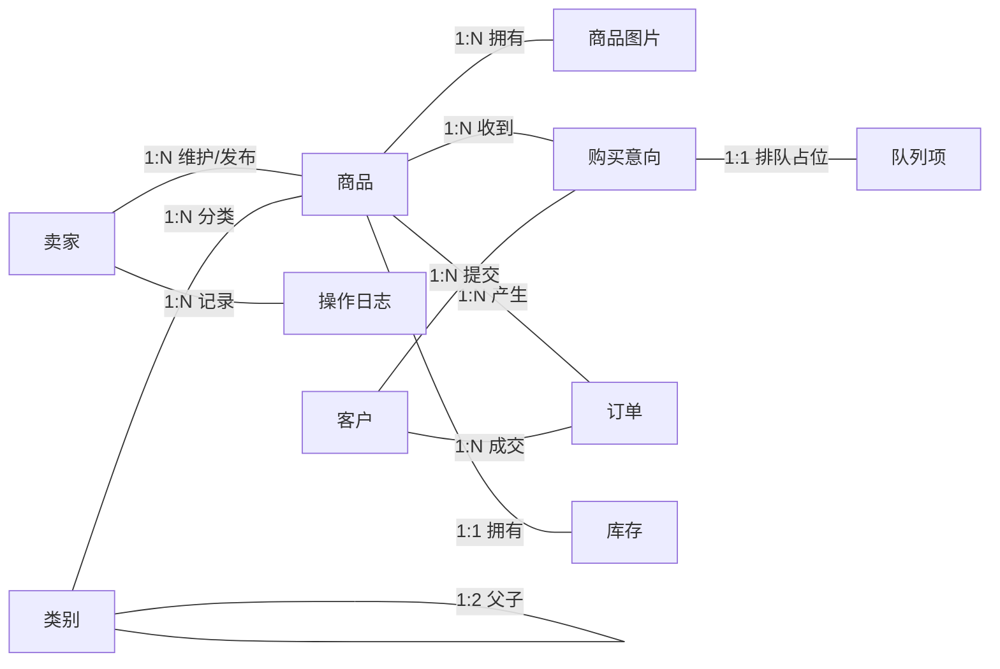

# 在线购物系统需求分析报告（挑战A升级版）

> **版本说明**：本版在基线（单卖家唯一在售 + 匿名口令码）基础上，经挑战 A 升级重构。
> 升级的核心思路：**「看不用登录，买必须登录」**、**多商品并发**、**库存驱动售卖**、**口令码/自动递补作废、排队/冻结保留并改造**。

## 目录

1. [项目概述](#1-项目概述)
2. [用户角色分析](#2-用户角色分析)
3. [业务流程分析](#3-业务流程分析)
4. [功能需求](#4-功能需求)
5. [非功能需求](#5-非功能需求)
6. [数据需求](#6-数据需求)
7. [接口需求](#7-接口需求)
8. [约束与假设](#8-约束与假设)
9. [验收标准](#9-验收标准)
10. [风险分析](#10-风险分析)
11. [待确认项](#11-待确认项)
12. [新增/变更内容对照](#12-新增变更内容对照)

---

## 1. 项目概述

### 1.1 项目背景

本系统是**单卖家 + 注册客户**模式的在线购物系统。卖家拥有唯一固定账号（无注册、无退出登录）。客户自由注册（用户名、密码、电话、默认交易地点），登录后方可下单并查看历史下单记录，游客可匿名浏览与搜索。交易默认线下进行。

系统可**同时发布多个商品**，支持**2 级类别**管理、**库存数量**控制（库存为 0 自动下架）、**多图片**与**富媒体**描述，客户可通过**浏览或搜索**查找商品。

### 1.2 系统架构概览

### 1.3 项目目标

- 卖家可同时发布并管理多个在售商品，维护类别树，手动补货/调整库存；
- 商品支持 2 级类别、库存控制、多图与富媒体描述；
- 客户可自由注册、登录、查看历史下单记录，浏览无需登录，下单必须登录；
- 每个商品独立排队（先到先得，不限人数），交易中冻结、冻结期不收新意向；
- 库存仅成交后扣减；库存为 0 自动下架，补货后恢复在售；
- 交易失败：库存不变、商品恢复在售，由卖家确认该单作废或重新排队（排到队尾）；
- 商家可查看所有注册客户信息及其购买历史。

### 1.4 业务约束

- 系统用户分三类：卖家、游客、注册客户。
- 卖家只有一个账号，账号固定指定，无注册流程，后台无退出登录功能。
- 客户**自由注册**：用户名、密码、电话、默认交易地点。
- **浏览、搜索、查看详情无需登录**；**下单必须登录**，「我要购买」未登录时引导注册/登录。
- 同一时间可**同时存在多个在售商品**。
- 商品支持**2 级类别**管理，类别树可增删改维护；已发布商品的类别不随类别维护而变化。
- 商品发布后**不可编辑**（名称、描述、图片、价格、类别均定死）；唯一可动字段为**库存数量**（后台补货/调整）。
- 商品支持**多张图片**，描述支持**富媒体**。
- 每个商品有**库存数量**；库存为 0 时商品**自动下架**。
- 商品可通过**浏览**和**搜索**被查找到。
- 每个商品**独立排队**，按提交时间**先到先得**，排队人数不设上限。
- 排队人数不受库存限制；仅在**库存为 0** 或**商品冻结**时停止接受新购买意向。
- 单个商品**同一时间只能与一个买家交易**；不同商品各自独立，可同时各自进行一单交易。
- 与买家进入交易时商品**自动冻结**，冻结期间不收新意向。
- 库存仅在**交易成功成交后减 1**；交易失败库存不变。
- 交易失败为**单动作**：商品立即恢复在售（库存为 0 则维持下架），并同步选定失败者**作废**或**重新排队（排到队尾）**。
- 客户登录后可查看**历史下单记录**。
- 买家**提交意向后无主动撤销、无修改意向信息入口**，仅可被动查看；意向只能被卖家处理（交易成功/失败/作废）或因售罄失效。
- 同一客户对同一商品**同时仅能有一个「有效意向」**（排队中/进入交易/重新排队中）；历史意向（成交/作废/售罄）不占排队资格。
- 客户可**同时在不同商品各自排队**（每商品独立）。
- 重新排队**不限次数**（由卖家在交易失败后确认，排到队尾）。
- 卖家**进入交易只能针对队列第一位**，严格先到先得。
- 库存为**非负整数，最低 0，不允许负库存**；手动调整同样封底到 0。
- 库存减为 0 时仍排队的意向自动进入**「售罄作废」**（带可见标记）；不允许超卖。
- 卖家**可对在售商品直接调库存到 0**，无需先手动下架；调到 0 的瞬间即触发「库存为 0 自动下架」。
- 商品多图最多 **9 张**，仅 **JPG/PNG**，单张 **≤5MB**；**首图即主图**，顺序按上传固定不调整。
- 富媒体描述仅支持**富文本内嵌图片与视频**；图片/视频均**本地上传**，不接受外链。
- 商品**必须归属二级类别（小类）**；类别仅支持**新增、重命名、删除**，不支持移动/换归属；**有商品的类别禁止删除**。
- **无通知机制**（站内信/短信/推送均不提供），客户需主动查看自己的意向与订单状态。
- 商家的客户台账仅展示固定字段：**用户名、电话、默认交易地点、注册时间及该客户的购买历史**。
- 本期**不做线上支付与物流**，默认线下交易，一手交钱一手交货。

---

### 1.5 术语表

| 术语 | 含义 |
|---|---|
| 卖家 | 唯一的后台运营者，账号系统固定指定，无注册/退出；负责发布商品、调库存、维护类别、处理交易与意向 |
| 客户 | 自主注册的用户，可登录下单；有用户名、密码、电话、默认交易地点；可查看自己的意向与历史下单 |
| 游客 | 未登录的访客，可浏览/搜索/看详情，不可下单；需注册登录后才可购买 |
| 商品 | 卖家发布的可售物品，归属二级类别，含名称/描述/价格/库存/图片，发布后不可编辑（仅库存可调） |
| 二级类别 | 商品的必挂归属（小类），为 2 级树结构的叶子节点；类别仅支持新增/重命名/删除 |
| 库存 | 每商品一个非负整数库存量；成交减 1；库存为 0 自动下架（售罄下架） |
| 在售 | 商品状态之一：可浏览/搜索/下单，可接受购买意向，库存 > 0 |
| 冻结 | 商品状态之一：与买家进入交易或手动冻结时可见不可买、不收新意向 |
| 售罄下架 | 商品状态之一：库存为 0 自动下架，可补货后恢复在售 |
| 手动下架 | 商品状态之一：卖家主动撤下退出在售，可重新上架 |
| 购买意向 | 客户在登录状态下对某商品表达的购买意愿，进入该商品独立队列排队 |
| 正在交易 | 与买家进入交易并冻结后，双方线下交易进行中的状态 |
| 交易成功 | 卖家标记成功，库存减 1，计入订单 |
| 交易失败 | 卖家标记失败，库存不变；同一动作内同步选定失败者作废或重新排队 |
| 作废 | 交易失败或售罄后，意向被终止的终态 |
| 重新排队 | 交易失败后，由卖家将失败者的意向放回该商品队列队尾（不限次数） |
| 售罄作废 | 商品库存减为 0 时，仍在排队中的意向被自动作废并打售罄标记 |
| 队列 | 每商品独立的先到先得购买意向排列表，人数不限 |
| 队列第一位 | 商品队列中最早提交、唯一可被卖家选中进入交易的意向 |
| 进入交易 | 卖家选中队列第一位开始线下交易，商品随之自动冻结 |
| 生效意向 | 同一客户对同一商品当前有效（占用排队资格）的意向；历史意向不占资格 |
| 客户台账 | 商家后台可查看的注册客户信息，仅含固定字段（用户名/电话/默认交易地点/注册时间）及购买历史 |
| 默认交易地点 | 客户注册时填写的线下交易约定地点 |

---

## 2. 用户角色分析

### 2.1 角色定义

| 角色 | 是否有账号 | 账号来源 | 核心权限 | 说明 |
|---|---|---|---|---|
| 卖家 | 有，唯一账号 | 系统固定指定，无注册流程 | 登录后台、发布商品、维护类别树、调库存、查看队列、进入交易、标记交易成败、作废/重新排队、查看客户台账与购买历史、修改密码 | 系统唯一后台使用者，账号预先创建；无退出登录功能；商品发布后不可编辑（仅库存可调） |
| 客户 | 有，可注册 | 自由注册 | 注册/登录、浏览与搜索、提交购买意向、查看自己的意向、查看历史下单记录 | 注册字段：用户名、密码、电话、默认交易地点；浏览无需登录，下单必须登录；**提交意向后无主动撤销、无修改意向信息入口** |
| 游客 | 无账号 | 无 | 匿名浏览、搜索、查看商品详情 | 不注册；想下单时必须先注册登录 |

> 💡 **说明：** 游客不是独立的"第三类长期用户"，只是"未登录的可浏览状态"。客户登录后拥有完整下单与历史查询能力。

### 2.2 权限矩阵

| 功能 | 卖家 | 客户 | 游客 |
|---|---|---|---|
| 浏览商品 | 可 | 可 | 可 |
| 搜索商品 | 可 | 可 | 可 |
| 查看商品详情 | 可 | 可 | 可 |
| 查看类别 | 可 | 可 | 可 |
| 发布商品 | 可，可多个同时 | 不可 | 不可 |
| 编辑商品 | 不可（发布后定死） | 不可 | 不可 |
| 调整库存（补货） | 可 | 不可 | 不可 |
| 维护类别树 | 可（增删改） | 不可 | 不可 |
| 注册/登录 | 不可 | 可 | 可（游客注册成为客户） |
| 提交购买意向 | 不可 | 可（必须登录） | 不可（需先登录） |
| 查看自己的意向 | 不可 | 可 | 不可 |
| 撤销/修改自己的意向 | 不可 | 不可（无此功能） | 不可 |
| 查看历史下单记录 | 不可 | 可 | 不可 |
| 查看客户台账及购买历史 | 可（仅固定字段） | 不可（仅自己） | 不可 |
| 查看排队队列 | 可 | 可（仅自己位置） | 不可 |
| 进入交易 | 可（仅队列第一位） | 不可 | 不可 |
| 标记交易成功/失败 | 可 | 不可 | 不可 |
| 失败者作废/重新排队 | 可 | 不可 | 不可 |
| 修改密码 | 可（卖家） | 可（客户） | 不可 |
| 退出登录 | 不需要 | 可 | 无账号 |

---

## 3. 业务流程分析

### 3.1 卖家主流程

> **流程说明：** 卖家发布多个商品后，客户登录提交意向进入该商品独立队列。卖家与队首进入交易时商品冻结，交易成功扣库存（为 0 则售罄下架），交易失败为**单动作**——同一时刻商品立即恢复在售（库存 0 则维持下架）并同步选定失败者作废或重新排队。

### 3.2 客户/游客主流程

> **流程说明：** 游客随意浏览搜索，下单必须登录。登录后提交意向进入商品队列，只能被动查看等待，无撤销/修改入口。成交或卖家处理后结束。

### 3.3 商品状态机

| 状态 | 说明 | 可流转到 |
|---|---|---|
| 草稿 | 已创建未发布，仅后台可见 | 在售 |
| 在售 | 可浏览/搜索/下单，可接受意向；库存>0 | 冻结、售罄下架、手动下架 |
| 冻结 | 交易中或手动冻结；可见不可买，不收新意向 | 在售（解冻/交易失败且库存>0 / 成交后仍有库存）、售罄下架 |
| 售罄下架 | 库存为 0 自动下架（成交归零或手动调到 0），排队意向作废 | 在售（补货后恢复）、手动下架 |
| 手动下架 | 卖家主动撤下，退出在售；不展示、不可买、不收新意向 | 在售（重新上架且库存>0） |

> **说明：** 「售罄下架」为统一的下架态（无论因成交还是手动调库存使库存归 0），均可通过补货恢复在售，不再区分终态下架。
> **待定：** 卖家手动下架时仍在排队中的意向如何处理（作废 or 保留待重新上架后继续排队）见 TBD-13，当前默认按作废处理。
> **待定：** 冻结中的「手动冻结/手动解冻」为未确认能力（TBD-15）；若不支持则商品仅因进入交易而自动冻结。

### 3.4 意向/订单状态机

| 状态 | 说明 | 可流转到 |
|---|---|---|
| 排队中 | 客户登录后提交，按提交时间排队，人数不限 | 进入交易、售罄作废 |
| 售罄作废 | 商品库存减为0自动下架，仍在排队中的意向自动失效 | 终态 |
| 进入交易 | 轮到该客户（仅队首），商品冻结 | 交易成功、交易失败 |
| 交易成功 | 成交，库存减1 | 终态 |
| 交易失败 | 未成交，库存不变 | 已作废、重新排队中 |
| 重新排队中 | 卖家选择放回队尾，不限次数 | 进入交易、已作废 |
| 已作废 | 卖家拒绝后作废 | 终态 |

> **说明：** 客户无主动撤销、无修改意向信息入口，故状态机无"已撤销"分支。客户提交意向后只能被动等待，意向终态仅能由卖家操作或售罄触发。

### 3.5 库存规则

| 项目 | 规则 |
|---|---|
| 扣减时机 | 仅「交易成功/成交」后减 1 |
| 交易失败 | 库存不变；标记失败瞬间商品恢复在售（库存0则维持下架） |
| 库存语义 | **非负整数，最低 0，不允许负库存**；手动调整亦封底到 0 |
| 库存为 0 | 商品自动下架；仍排队中的意向自动「售罄作废」 |
| 调库存到0 | 在售商品可直接把库存调到0，无需先手动下架；调到0瞬间即自动下架 |
| 补货 | 卖家后台手动调整库存（可增可减，下限 0），调整为 >0 后商品恢复在售 |
| 库存对排队的影响 | 库存管"能不能继续收意向/何时下架"，**不给排队人数设上限**；不允许超卖 |

### 3.6 排队与冻结规则

| 项目 | 规则 |
|---|---|
| 排队时机 | 商品在售且库存>0，客户登录后提交意向 |
| 队列归属 | 每个商品独立队列 |
| 排队顺序 | 按提交时间先到先得 |
| 排队人数 | 不限，不受库存限制 |
| 停止收意向 | 仅两个条件：库存=0 或 商品冻结 |
| 冻结时机 | 与买家进入交易时自动冻结；手动冻结见 TBD-15（未确认，若不做则仅自动冻结） |
| 冻结后 | 不收新意向 |
| 进入交易对象 | **仅队列第一位**，严格先到先得，卖家不得选其他排队者 |
| 单商品并发 | 同时只与一个买家交易；不同商品可同时各有交易 |
| 交易成功 | 库存减1；库存为0则下架，否则恢复在售继续排队 |
| 交易失败 | 单动作：标记失败瞬间商品恢复在售（库存0则维持下架），并同步选定失败者作废/重新排队(排到队尾, 不限次) |
| 客户撤销 | **无撤销功能**，客户提交意向后只能被动等待 |

### 3.7 客户页面与购买规则

| 场景 | 客户/游客看到什么 | 能否下单 |
|---|---|---|
| 未登录，浏览/搜索 | 商品列表、详情、类别 | 不能，点「我要购买」引导注册/登录 |
| 已登录，商品在售 | 商品详情 + 「我要购买」 | 可以，提交意向进入队列 |
| 商品冻结 | 商品信息 + 「商品交易中」 | 不能，不收新意向 |
| 库存为 0（下架） | 商品不展示或标记售罄 | 不能 |
| 已登录客户 | 可查看自己的意向状态（被动等待）、历史下单记录 | — |
| 我的意向（售罄） | 提示"商品已售罄，意向失效" | — |

### 3.8 卖家后台功能入口

| 入口 | 功能 | 说明 |
|---|---|---|
| 发布商品 | 发布新商品，支持多个同时在售 | 选类别（2级）、填名称/描述（富媒体）、价格、库存、上传多图 |
| 类别管理 | 维护 2 级类别树 | 仅**新增/重命名/删除**，无移动；商品必挂二级；有商品的类别禁止删除 |
| 库存管理 | 手动补货/调整库存 | 库存为0自动下架，调整>0恢复 |
| 查看队列 | 查看各商品当前意向队列 | 显示客户、时间、位置、状态 |
| 进入交易 | 与队列第一位进入交易 | 进入后商品自动冻结 |
| 标记结果 | 交易成功/失败（单动作） | 成功减库存；失败瞬间商品恢复在售（库存0则维持下架）并同步选定失败者作废/重新排队(排到队尾, 不限次) |
| 客户台账 | 查看所有注册客户信息 | 含购买历史 |
| 修改密码 | 修改卖家登录密码 | — |

> 后台不提供：编辑已发布商品、退出登录、多卖家管理。

---

## 4. 功能需求

> 📌 以下按模块分类。标注【增】为挑战 A 新增，【改】为在原基线基础上改造，【废】为挑战 A 作废项（列表内不再出现）。

### 4.1 商品管理

| 编号 | 需求 | 角色 | 说明 | 验收标准 |
|---|---|---|---|---|
| FR-001 | 多商品同时在售【改】 | 卖家 | 可同时发布多个商品，不受数量限制 | 多件商品可同时上架并可各自售卖 |
| FR-002 | 发布商品【改】 | 卖家 | 填名称、描述、价格（>0，最多两位小数，人民币元）、库存、类别、多图片 | 保存后客户可见；不要求关闭其他商品 |
| FR-003 | 2级类别【增】 | 卖家 | 商品归属大类>小类两级，**必须挂二级** | 商品必挂小类，不允许多有类无小类 |
| FR-004 | 类别树维护【增】 | 卖家 | 类别仅**新增/重命名/删除**，无移动/换归属 | 增删改生效；**有商品的类别禁止删除**；已发布商品类别不随之变 |
| FR-005 | 库存数量【增】 | 卖家/系统 | 每商品有库存（**非负整数**）；库存为0自动下架 | 库存为0时商品自动下架；不允许负库存 |
| FR-006 | 手动补货/调库存【增】 | 卖家 | 后台调整库存（可增可减，下限0） | 调整>0后商品恢复在售 |
| FR-007 | 商品不可编辑【改】 | 系统 | 发布后名称、描述、图片、价格、类别均不可改 | 后台无编辑入口；修改被拒绝 |
| FR-008 | 多图商品【增】 | 卖家/系统 | 商品支持多图，**最多9张，仅JPG/PNG，单张≤5MB；首图即主图，顺序按上传固定** | 可上传并展示多张图片 |
| FR-009 | 富媒体描述【增】 | 卖家/系统 | 描述支持富文本内嵌**图片与视频**，均**本地上传**，不接受外链 | 描述可含富媒体内容 |
| FR-010 | 搜索商品【增】 | 客户/游客 | 按关键词/名称/类别检索 | 可搜到匹配商品 |
| FR-011 | 商品下架【改】 | 卖家 | 手动下架/售罄自动下架 | 下架后不可购买 |
| FR-012 | 历史商品【改】 | 卖家 | 查看已成交、下架、售罄商品 | 含库存、成交、交易记录 |

### 4.2 库存与下架

| 编号 | 需求 | 角色 | 说明 | 验收标准 |
|---|---|---|---|---|
| FR-013 | 成交才扣库存【增】 | 系统 | 仅交易成功减1 | 交易失败不减库存 |
| FR-014 | 库存0自动下架【增】 | 系统 | 库存减为0自动下架，排队意向自动售罄作废 | 库存0时不再收新意向，对排队意向作废 |
| FR-015 | 补货恢复【增】 | 卖家 | 库存调整为>0后恢复在售 | 补货后商品可再收意向 |
| FR-015A | 非负库存【增】 | 系统 | 库存为非负整数，最低0 | 不允许出现负库存 |

### 4.3 客户账号与浏览/下单

| 编号 | 需求 | 角色 | 说明 | 验收标准 |
|---|---|---|---|---|
| FR-017 | 客户注册【增】 | 客户 | 用户名、密码、电话、默认交易地点 | 注册成功可登录 |
| FR-018 | 客户登录/登出【增】 | 客户 | 用户名密码登录 | 登录成功，失败有提示 |
| FR-019 | 游客浏览/搜索【增】 | 游客 | 无需登录浏览、搜索、看详情 | 游客可浏览搜索详情，不可下单 |
| FR-020 | 下单强制登录【增】 | 客户 | 「我要购买」需登录，未登录引导注册 | 未登录点购买被引导登录/注册 |
| FR-021 | 提交购买意向【改】 | 客户 | 登录后提交意向进入商品队列；**同商品同时仅一个有效意向** | 提交成功进入队列；重复提交被拒 |

### 4.4 排队与交易

| 编号 | 需求 | 角色 | 说明 | 验收标准 |
|---|---|---|---|---|
| FR-022 | 独立队列【增】 | 系统 | 每个商品独立队列，客户可同时在多个商品排队 | 各商品队列互不影响 |
| FR-023 | 先到先得【改】 | 系统 | 按提交时间排序 | 最早提交排最前 |
| FR-024 | 人数不限【增】 | 系统 | 排队人数不设上限，不受库存限制 | 库存>0可接收多个意向 |
| FR-025 | 查看意图状态【改】 | 客户 | 仅可查看自己的意向位置/状态，**无撤销与修改** | 无撤销入口；不可改意向信息 |
| FR-026 | 交易冻结【改】 | 系统 | 与买家进入交易商品冻结，不收新意向 | 冻结期新意向被拒 |
| FR-027 | 单商品单交易【增】 | 系统 | 单商品同时只与**队列第一位**交易 | 并发下单不冲突；不可选非队首 |
| FR-028 | 交易成功【改】 | 卖家 | 标记成功，库存减1 | 库存减少；库存0则下架 |
| FR-029 | 交易失败【改】 | 卖家 | 标记失败，库存不变，商品立即恢复在售（与确认失败者同一动作） | 库存不变；库存>0则恢复收意向；库存0则不恢复 |
| FR-030 | 失败者处理【改】 | 卖家 | 标记失败时同步选择失败者作废或重新排队(排到队尾，不限次数) | 唯一动作内完成；仅影响失败者本人 |

### 4.5 客户历史与商家台账

| 编号 | 需求 | 角色 | 说明 | 验收标准 |
|---|---|---|---|---|
| FR-031 | 客户历史下单【增】 | 客户 | 客户登录查看自己的历史下单记录 | 列表含商品、状态、时间 |
| FR-032 | 商家客户台账【增】 | 卖家 | 查看所有注册客户，字段固定：**用户名、电话、默认交易地点、注册时间** | 仅展示固定字段 |
| FR-033 | 商家购买历史【增】 | 卖家 | 查看客户购买历史 | 可追溯客户历次购买/意向记录 |
| FR-034 | 售罄作废【增】 | 系统 | 库存为0时仍在排队中的意向自动作废并标记"售罄" | 意向显示"已售罄，失效"，不允许超卖 |

### 4.6 卖家后台

| 编号 | 需求 | 角色 | 说明 | 验收标准 |
|---|---|---|---|---|
| FR-035 | 卖家登录【改】 | 卖家 | 固定账号+用户名密码 | 成功/失败有提示 |
| FR-036 | 无注册/无退出登录【改】 | 系统 | 单一固定账号，无注册无退出 | 无相关入口 |
| FR-037 | 修改密码【改】 | 卖家 | 校验旧密码，新密码≥8位 | 修改成功 |
| FR-038 | 类别树维护【增】 | 卖家 | 2级类别仅新增/重命名/删除 | 生效且不影响已发布商品 |
| FR-039 | 库存调整【增】 | 卖家 | 手动补货/调库存（非负） | 调整生效，不允许负值 |
| FR-040 | 操作日志【改】 | 系统 | 记录卖家关键操作 | 日志可查 |

### 4.7 终端与过程需求

| 编号 | 需求 | 说明 | 验收标准 |
|---|---|---|---|
| FR-041 | 卖家后台 Web | 卖家管理主入口 | 核心功能可用 |
| FR-042 | 买家 Web/H5 | 浏览、搜索、注册登录、下单、历史记录 | 响应式适配 |
| FR-043 | Scrum 过程 | Product/Sprint Backlog、评审回顾、站会 | 有对应记录 |

---

## 5. 非功能需求

| 编号 | 类别 | 需求 |
|---|---|---|
| NFR-001 | 性能 | 商品列表/详情/搜索响应小于 2 秒 |
| NFR-002 | 安全 | 密码哈希存储，HTTPS，防 CSRF、XSS、SQL 注入 |
| NFR-003 | 账号安全 | 客户/卖家密码哈希存储，支持修改密码 |
| NFR-004 | 数据隐私 | 客户信息（电话、交易地点）受保护，仅授权范围内可见 |
| NFR-005 | 库存一致性 | 成交扣减、并发下单需保证库存与队列顺序一致，防止超卖 |
| NFR-006 | 先到先得 | 队列严格按提交时间，不可人为干预 |
| NFR-007 | 可用性 | 系统可用性不低于 99% |
| NFR-008 | 兼容性 | 支持主流浏览器；移动端适配以最终终端范围为准 |
| NFR-009 | 可维护性 | 模块化、接口文档、日志规范 |
| NFR-010 | 审计 | 卖家关键操作可追溯，交易/库存变更完整记录 |
| NFR-011 | 备份 | 数据库定期备份，可恢复 |
| NFR-012 | 上传 | 图片/富媒体上传需校验类型与大小，防恶意上传 |

---

## 6. 数据需求

### 6.1 实体关系图

### 6.2 主要实体

| 实体 | 说明 |
|---|---|
| 卖家 | 唯一固定账号，系统初始化写入，无注册无退出登录 |
| 客户 | 注册客户：用户名、密码哈希、电话、默认交易地点 |
| 类别 | 2 级树结构，支持增删改；已发布商品类别不随之变 |
| 商品 | 名称、富媒体描述、价格、类别、状态；支持多图；发布后不可编辑 |
| 商品图片 | 多张，带排序 |
| 库存 | 每商品一个库存数；成交减1，手动补货调整（非负，下限0）；为0自动下架 |
| 意向单 | 客户对某商品的购买意向（客户ID+商品ID唯一有效意向），含状态，进入该商品独立队列；无撤销，可售罄作废 |
| 排队队列 | 商品ID、意向ID、位次、提交时间；每商品独立，先到先得 |
| 订单 | 成交后生成，记录商品、客户、意向、结果、时间 |
| 客户台账/历史 | 商家可查客户信息及其购买历史 |
| 操作日志 | 卖家关键操作留痕 |

---

## 7. 接口需求

| 接口类型 | 说明 |
|---|---|
| 公开接口 | 商品列表、商品详情、搜索、类别浏览；游客可用 |
| 客户接口 | 注册、登录、个人信息、提交意向、查看意向状态、历史下单记录 |
| 卖家接口 | 登录、发布商品、类别管理、库存调整、查看队列、进入交易、标记结果（成功/失败单动作含失败者作废/重新排队）、客户台账、购买历史、修改密码 |
| 文件接口 | 商品多图、富媒体上传 |

---

## 8. 约束与假设

1. 系统用户三类：卖家、客户、游客。
2. 卖家只有一个固定账号，无注册流程，后台无退出登录。
3. 客户自由注册（用户名、密码、电话、默认交易地点），可登录查看历史下单记录。
4. 浏览、搜索、查看详情无需登录；下单（提交购买意向）必须登录。
5. 同一时间可同时存在多个在售商品。
6. 商品支持 2 级类别，**必须归属二级（小类）**；类别仅**新增/重命名/删除**，无移动；**有商品的类别禁止删除**，已发布商品类别不随之变化。
7. 商品发布后不可编辑（名称、描述、图片、价格、类别定死）；唯一可动字段为库存数量。
8. 商品支持**最多9张图**（JPG/PNG，单张≤5MB，首图做主图，顺序按上传固定）、富媒体描述（富文本内嵌图片与视频，本地上传）。
9. 每个商品有库存（**非负整数，最低0**）；成交后减1；库存为0自动下架，补货>0后恢复在售。
10. 每个商品独立排队，先到先得，人数不限，不受库存限制；客户可同时在多个商品排队。
11. 仅在库存为0或商品冻结时停止接受新意向；库存为0时仍排队中的意向自动「售罄作废」。
12. 单商品同时只与**队列第一位**交易；不同商品可同时各交易一单。
13. 进入交易时商品自动冻结，冻结期不收新意向。
14. 交易成功扣库存、库存0则下架；交易失败库存不变、商品恢复在售（库存0则维持下架）。
15. 交易失败由卖家确认作废或重新排队（排到队尾，**不限次数**），仅影响失败者本人。
16. 商家客户台账仅展示固定字段：用户名、电话、默认交易地点、注册时间及该客户的购买历史。
17. 客户提交意向后**无主动撤销、无修改意向信息**，仅被动查看；同一客户对同一商品同时仅一个有效意向。
18. **无通知机制**（站内信/短信/推送均无）；本期**不做线上支付与物流**，默认线下交易，一手交钱一手交货。

---

## 9. 验收标准

| 编号 | 验收项 | 标准 |
|---|---|---|
| AC-001 | 多商品同时在售 | 可同时上架多个商品并各自售卖 |
| AC-002 | 2级类别 | 商品必须归属二级类别，可浏览/筛选；类别仅新增/重命名/删除 |
| AC-003 | 库存控制 | 库存为0自动下架，补货>0恢复在售；不允许负库存 |
| AC-004 | 多图/富媒体 | 商品支持多图（9张/JPG·PNG/≤5MB/首图主图）与富媒体（图文视频，本地上传） |
| AC-005 | 浏览与搜索 | 游客/客户可浏览、搜索、看详情，无需登录 |
| AC-006 | 客户注册 | 用户名/密码/电话/默认交易地点注册成功 |
| AC-007 | 下单强制登录 | 未登录点「我要购买」引导注册/登录 |
| AC-008 | 客户历史下单 | 客户登录可查看自己的历史下单记录 |
| AC-009 | 商家客户台账 | 商家仅可查看固定字段（用户名/电话/默认交易地点/注册时间）及购买历史 |
| AC-010 | 独立队列 | 每商品独立队列，先到先得，人数不限；可多商品同时排队 |
| AC-011 | 交易冻结 | 进入交易商品冻结，冻结期不收新意向 |
| AC-012 | 单商品单交易 | 单商品同时只与队列第一位交易 |
| AC-013 | 成交扣库存 | 成交后库存减1，不允许超卖 |
| AC-014 | 失败不减库存 | 交易失败库存不变，商品恢复在售（库存0则维持下架） |
| AC-015 | 失败者处理 | 卖家作废或重新排队（排到队尾，不限次数） |
| AC-016 | 无撤销 | 客户无法撤销意向、无法修改意向信息 |
| AC-017 | 售罄作废 | 库存为0时排队中的意向自动作废并标记售罄 |
| AC-018 | 交易失败单动作 | 标记失败瞬间商品恢复在售（库存0则维持下架）并同步选定失败者作废/重新排队，无二次独立确认 |
| AC-019 | 调库存到0即下架 | 在售商品可直接把库存调到0，无需先手动下架，调0瞬间自动下架 |

---

## 10. 风险分析

| 风险 | 影响 | 应对 |
|---|---|---|
| 库存与下单并发 | 超卖或顺序错乱 | 库存扣减与队列顺序用事务+锁保证；成交时才减库存 |
| 多商品并发交易 | 不同商品同时交易状态错乱 | 状态机+商品维度锁 |
| 客户数据隐私 | 合规风险 | 台账仅展示固定字段，数据最小化、权限分级、日志审计 |
| 富媒体/多图上传 | XSS/恶意文件 | 类型与大小校验、富媒体净化（本地上传） |
| 2级类别变更 | 归类混乱 | 类别仅新增/重命名/删除，无移动；有商品类别禁止删除 |
| 重新排队 | 死循环占位 | 明确"排到队尾、不限次数"，保证先到先得 |
| 售罄作废 | 排队意向下落不明 | 库存0自动触发作废并打售罄标记，客户可见 |
| 手动下架时排队意向 | 意向下落不明/争议（作废 or 保留待重新上架） | 见 TBD-13，当前默认作废并提示客户 |
| 多意向/公平性 | 一人多意向挤占 | 同商品同客户仅一个有效意向 |
| 无撤销机制 | 客户意向无法撤回 | 明确无撤销，客户侧只读，避免混淆 |
| 单卖家账号 | 无法多卖家扩展 | 明确单卖家模式，不提供注册入口 |

---

## 11. 待确认项

| 编号 | 待确认项 | 说明 |
|---|---|---|
| TBD-01 | 支付管理 | 线上支付、退款、对账是否纳入？当前默认线下（本期不做） |
| TBD-02 | 配送管理 | 自提/卖家配送/物流是否纳入？「默认交易地点」用途待明确 |
| TBD-03 | 评价功能 | 成交后是否评价？ |
| TBD-04 | 营销管理 | 优惠券、满减、秒杀、拼团是否纳入？ |
| TBD-05 | 富媒体白名单格式 | 富文本图片/视频的具体支持与净化格式细节 |
| TBD-06 | 交易超时机制 | 卖家进入交易后无限期不标记结果时，是否需要超时兜底 |
| TBD-07 | 通知机制 | 无通知（已确认）；后续若加轮询/短信另行立项 |
| TBD-08 | 统计报表 | 销售、库存、客户报表是否纳入？ |
| TBD-09 | 终端范围 | Web、Android、iOS、小程序是否全做？ |
| TBD-10 | 团队与工期 | 团队人数、总工期、Sprint 长度、每人投入 |
| TBD-11 | 验收方式 | 谁验收、必须演示哪些端到端流程 |
| TBD-12 | 交付物 | 源码、文档、部署、演示视频是否都要 |
| TBD-13 | 手动下架时排队意向 | 卖家手动下架时，仍在排队中的意向是**作废**还是**保留等待重新上架后继续排队**（当前默认作废，待定） |
| TBD-14 | 重新排队时间基准 | 失败者重新排队到队尾的位次，以「卖家确认重新排队的时刻」计序（待最终确认）；需明确与恢复在售期间新来排队者谁先谁后 |
| TBD-15 | 手动冻结能力 | 卖家是否支持「手动冻结/解冻」商品以主动暂停收意向（约束与目标未定义此能力，仅状态机/排表出现）；若不做则移除冻结的手动入口，仅保留「进入交易自动冻结」 |

---

## 12. 新增/变更内容对照

| 编号 | 变更说明 | 类型 |
|---|---|---|
| C-01 | 单商品在售 → 多商品同时在售 | 改 |
| C-02 | 新增 2 级类别管理 | 增 |
| C-03 | 新增库存数量，库存0自动下架，成交扣1，补货调整 | 增 |
| C-04 | 新增多图片、富媒体描述 | 增 |
| C-05 | 新增浏览与搜索两种查找方式 | 增 |
| C-06 | 匿名买家 → 注册客户（用户名/密码/电话/默认交易地点） | 改 |
| C-07 | 「看不用登录，买必须登录」 | 改 |
| C-08 | 客户登录查看历史下单记录 | 增 |
| C-09 | 商家查看所有注册客户信息及购买历史 | 增 |
| C-10 | 口令码机制作废 | 废 |
| C-11 | 自动递补作废，改为卖家确认作废/重新排队（排到队尾） | 改 |
| C-12 | 排队保留（每商品独立、先到先得、不限人数、可多商品同时排队） | 保留 |
| C-13 | 冻结保留（交易中冻结、冻结期不收新意向） | 保留 |
| C-14 | 商品发布后不可编辑（仅库存可调） | 保留（基线一致性） |
| C-15 | 撤销/修改意向作废：客户无主动撤销、无修改意向信息 | 废 |
| C-16 | 重新排队不限次数，排到队尾 | 改 |
| C-17 | 进入交易仅限队列第一位（先到先得） | 改 |
| C-18 | 库存非负整数，不允许负库存 | 增 |
| C-19 | 售罄作废：库存0时排队意向自动作废并标记 | 增 |
| C-20 | 多图细则：9张/JPG·PNG/≤5MB/首图主图/顺序固定 | 增 |
| C-21 | 富媒体：仅富文本内嵌图文视频，本地上传 | 增 |
| C-22 | 类别细则：必挂二级、仅增删改、有商品禁删、无移动 | 增 |
| C-23 | 无通知机制 | 确认 |
| C-24 | 商家台账仅展示固定字段 | 改 |
| C-25 | 本期不做线上支付/物流 | 确认 |
| C-26 | 交易失败为单动作（恢复在售+选定失败者同时完成） | 确认 |
| C-27 | 在售商品可直接调库存到0即自动下架，无需先手动下架 | 确认 |
| C-28 | 「成交下架」移除，统一为「售罄下架」可补货恢复 | 改 |
| C-29 | 商品状态枚举对齐为 草稿/在售/冻结/售罄下架/手动下架 | 改 |
| C-30 | 「手动冻结/解冻」能力待确认（TBD-15），约束未定义 | 待确认 |