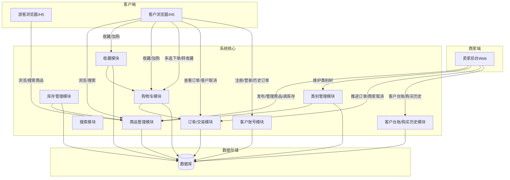
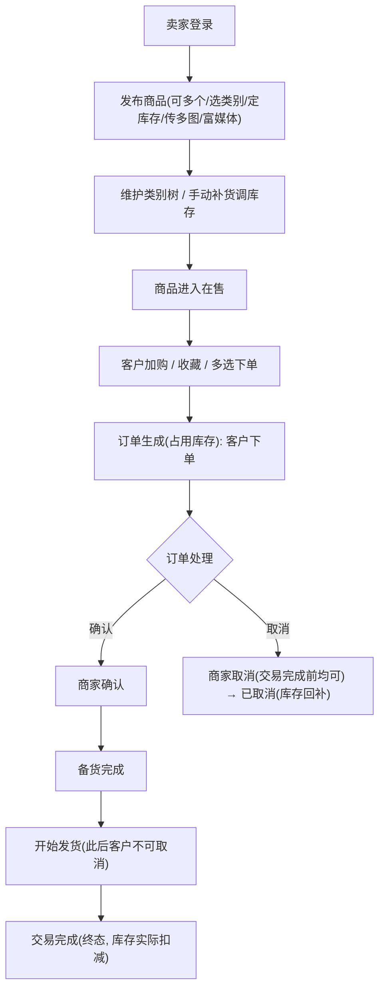
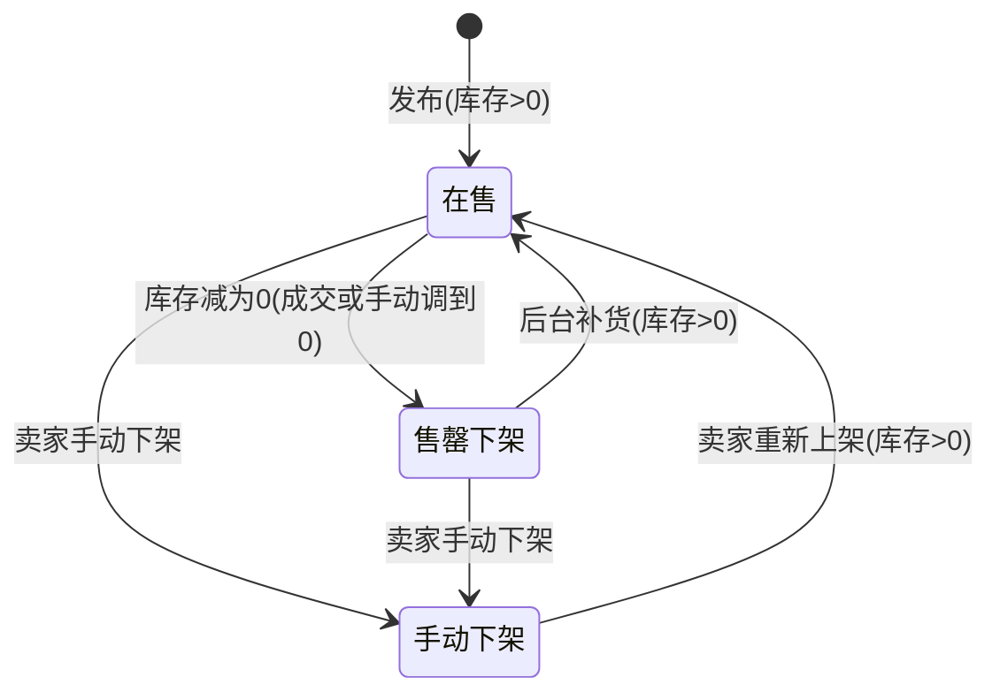
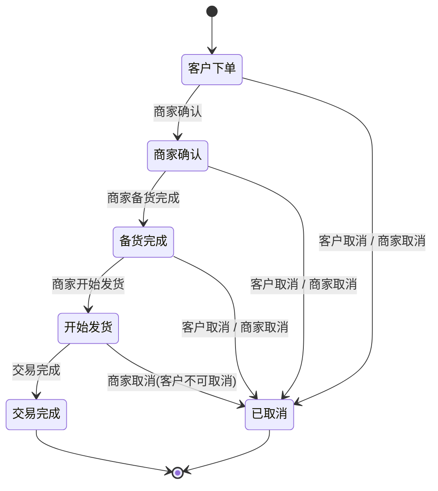
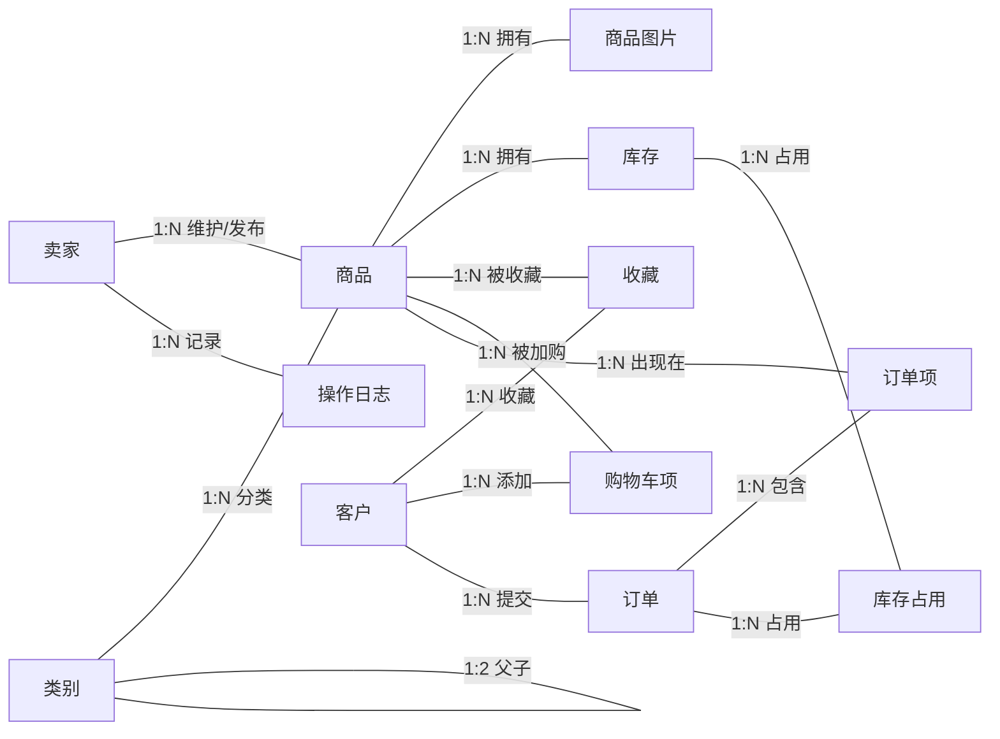

# 在线购物系统需求分析报告（挑战B升级版）

> **版本说明**：本版为挑战 B 确认稿。经需求评审确认，**挑战 B 全面落地，取代挑战 A 的「意向 → 排队 → 先到先得 → 冻结 → 成交扣库存」模型**。
> 挑战 B 升级核心：
> - **B.1 订单升级**：从"提交购买意向排队"升级为"购物车选件下单 + 完整订单生命周期（5 态 + 双向取消）"；
> - **B.2 商品预选升级**：新增**收藏**、**购物车**、购物车**多件下单**、购物车**多件转收藏**。
> 由此，客户购买路径变为「浏览/搜索 → 加购/收藏 → 从购物车选单件或多件下单 → 订单 5 态流转」；库存改为**下单占用 → 取消回补 → 完成扣减**。


## 目录

1. [项目概述](#1-项目概述)
2. [用户角色分析](#2-用户角色分析)
3. [业务流程分析](#3-业务流程分析)
4. [功能需求](#4-功能需求)
5. [非功能需求](#5-非功能需求)
6. [数据需求](#6-数据需求)
7. [接口需求](#7-接口需求)
8. [约束与假设](#8-约束与假设)
9. [验收标准](#9-验收标准)
10. [风险分析](#10-风险分析)
11. [待确认项](#11-待确认项)
12. [需求变更清单](#12-需求变更清单)

---

## 1. 项目概述

### 1.1 项目背景

本系统是**单卖家 + 注册客户**模式的在线购物系统。卖家拥有唯一固定账号（无注册、无退出登录）。客户自由注册（用户名、密码（≥8位+强度要求）、电话、默认交易地点）；**下单需登录**，未登录时的**临时收藏/加购**会在登录后自动合并进账号，客户可查看历史订单。游客可匿名浏览与搜索，并可在未登录状态下**临时**收藏、加购。

系统可**同时发布多个商品**，支持 **2 级类别**管理、**库存数量**控制（库存为 0 自动下架）、**多图片**与**富媒体**描述。客户通过**浏览或搜索**查找商品，可**收藏**心仪商品、将商品**加入购物车**，从购物车**多选一键下单**（生成含多订单项的订单）或将**多选中转收藏**。

### 1.2 系统架构概览



### 1.3 项目目标

- 卖家可同时发布并管理多个在售商品，维护类别树，手动补货/调整库存；
- 商品支持 2 级类别、库存控制、多图与富媒体描述；
- 客户可自由注册、登录、查看历史订单记录；浏览无需登录；未登录可**临时**收藏/加购（**登录后自动合并**）；**下单必须登录**；
- 客户可**收藏商品**、将商品**加入购物车**，从购物车**多选一键下单**，或将购物车中商品**多选转收藏**；
- **订单具备完整生命周期**：客户下单 → 商家确认 → 备货完成 → 开始发货 → 交易完成，由商家后台一步步推进，客户侧只读不可推进；
- **支持双向取消**：客户在订单进入「开始发货」前可取消；商家在订单进入「交易完成」前可取消；取消后订单标「已取消」，各商品库存回补；
- 商家可查看所有注册客户信息及其购买历史。

### 1.4 业务约束

- 系统用户分三类：卖家、游客、注册客户。
- 卖家只有一个账号，账号固定指定，无注册流程，后台无退出登录功能。
- 客户**自由注册**：用户名、密码（≥8位+强度要求）、电话、默认交易地点。
- **浏览、搜索、查看详情无需登录**；未登录可**临时**收藏、加购物车（存于匿名会话），**登录后自动恢复/合并**进账号；**下单必须登录**，未登录点下单时引导注册/登录。
- 同一时间可**同时存在多个在售商品**。
- 商品支持 **2 级类别**管理，类别树可增删改维护；已发布商品的类别不随类别维护而变化。
- 商品发布后**不可编辑**（名称、描述、图片、价格、类别均定死）；唯一可动字段为**库存数量**（后台补货/调整）。
- 商品支持**多张图片**，描述支持**富媒体**。
- 每个商品有**库存数量**（**非负整数，最低0**）；库存为 0 时商品**自动下架**；**不允许超卖**。
- **库存规则**：**提交下单即占用（真扣减，非仅标记）** → **取消时逐件回补** → **交易完成时核销扣减**。
  - **可售数量 = 原始库存 − 已下单占用量**（下单后按"剩余库存"展示，不按原始库存）；
  - **占用即锁死可售**：已被订单占用的数量，其他订单不可再下单（下单时校验库存，不足单项提示缺货、不可下单，防止超卖）；
  - **下单时逐商品校验库存**：缺货的单项提示、剔除，不拖累其他充足商品（已确认 TBD-04）；
  - **购物车/收藏不占用库存**（加购/收藏不占位、不锁），真正占用发生在**提交下单那一刻**；
  - **调库存到 0** 仅把「剩余可售库存」归零（商品自动下架、停止接受新下单），**不影响已经在下单/流转中的订单**；需求无"调库存触发强制取消"规则（已确认 TBD-05）。
- 商品可通过**浏览**和**搜索**被查找到；商品多图最多 9 张，仅 JPG/PNG，单张≤5MB，首图即主图，顺序按上传固定；富媒体仅富文本内嵌本地上传的图片与视频。
- 客户可**收藏**任意在售商品，进「我的收藏」；可取消收藏；**收藏不锁库存、不占位**；商品下架后收藏项**保留**，但标注「已下架/无货」。
- 客户可把商品**加入购物车**；购物车按客户独立，展示**名称、单价、数量、小计**；可**调数量、移除**；**购物车不锁库存**。
- 客户可从购物车**选单件或多件下单**，一次生成订单（含多个订单项）；**下单成功后，所选购物车项自动移除**（已确认 TBD-06）。
- **下单必经购物车**：仅支持「从购物车选件提交下单」，无商品详情页"立即购买"旁路（已确认 TBD-14）。
- 客户可从购物车**多选若干商品追加进收藏**。
- **订单 5 态**：客户下单 → 商家确认 → 备货完成 → 开始发货 → 交易完成；由**商家后台一步步推进**，客户侧**只读**。
- **客户取消**：订单处于「客户下单 / 商家确认 / 备货完成」（即尚未到「开始发货」）时可取消；进入「开始发货」后客户不可取消。
- **商家取消**：订单处于「交易完成」之前的任一状态下（含 开始发货）时，商家可取消；「交易完成」后不可取消。
- 取消后订单标记**「已取消」**，该订单各商品的**占用库存回补**。
- 客户登录后可查看**历史订单记录**（含已取消；记录含 订单号、商品清单、总金额、下单时间、状态/结果，见 TBD-09）。
- **无通知机制**（站内信/短信/推送均不提供），客户需主动查看订单状态。
- 商家的客户台账仅展示固定字段：**用户名、电话、默认交易地点、注册时间及该客户的购买历史**。
- 本期**不做线上支付与物流**，默认线下交易；「开始发货/交易完成」为线下协商后的状态推进（具体含义见 TBD-08）。

---

### 1.5 术语表

| 术语 | 含义 |
|---|---|
| 卖家 | 唯一的后台运营者，账号系统固定指定，无注册/退出；负责发布商品、调库存、维护类别、推进/取消订单 |
| 客户 | 自主注册的用户，可登录预选与下单；有用户名、密码（≥8位+强度要求）、电话、默认交易地点；可查看收藏、购物车与历史订单 |
| 游客 | 未登录的访客，可浏览/搜索/看详情，可**临时**收藏/加购（登录后自动恢复合并）；**下单必须登录** |
| 商品 | 卖家发布的可售物品，归属二级类别，含名称/描述/价格/库存/图片，发布后不可编辑（仅库存可调） |
| 二级类别 | 商品的必挂归属（小类），为 2 级树结构的叶子节点；类别仅支持新增/重命名/删除 |
| 在售 | 商品状态之一：可浏览/搜索/收藏/加购/下单，库存 > 0 |
| 收藏 | 客户对商品的喜好标记，加入「我的收藏」；不锁库存、不占位 |
| 购物车 | 客户预选容器，记录名称/单价/数量/小计；支持调数量、移除、多选下单、多选转收藏；不锁库存 |
| 购物车项 | 购物车中一条记录（某客户 + 某商品 + 数量），同一商品唯一 |
| 占用库存 | 提交下单时对该订单各订单项对应库存的占用（真扣减）；可售=原始−占用，占用锁死可售；取消时逐件回补、完成时核销扣减 |
| 售罄下架 | 商品状态之一：库存为 0 自动下架，可补货后恢复在售 |
| 手动下架 | 商品状态之一：卖家主动撤下退出在售，可重新上架 |
| 订单 | 客户从购物车选件下单生成的交易单位，含多个订单项，具生命周期 |
| 订单号 | 订单唯一业务编号，存于历史记录；格式=日期+自增序号（已确认 TBD-10） |
| 订单项 | 订单中的一条商品明细（该商品 + 数量 + 单价等） |
| 下单 | 订单状态之一：客户下单生成订单后的初始态，等待商家确认 |
| 商家确认 | 订单状态之一：商家接单确认 |
| 备货完成 | 订单状态之一：商家完成备货 |
| 开始发货 | 订单状态之一：商家开始发货（此后客户不可取消） |
| 交易完成 | 订单状态之一：交易完成，订单终态，库存实际扣减；此后商家不可取消 |
| 已取消 | 订单终态：客户取消或商家取消后的状态，占用库存回补 |
| 默认交易地点 | 客户注册时填写的线下交易约定地点（档案字段，不随下单固化） |

---

## 2. 用户角色分析

### 2.1 角色定义

| 角色 | 是否有账号 | 账号来源 | 核心权限 | 说明 |
|---|---|---|---|---|
| 卖家 | 有，唯一账号 | 系统固定指定，无注册流程 | 登录后台、发布商品、维护类别树、调库存、查看订单、推进订单（确认/备货/发货/完成）、取消订单（交易完成前）、查看客户台账与购买历史、修改密码 | 系统唯一后台使用者；无退出登录；商品发布后不可编辑（仅库存可调） |
| 客户 | 有，可注册 | 自由注册 | 注册/登录、浏览与搜索、收藏商品、加入购物车、调整/移除购物车项、购物车多选下单、购物车多选转收藏、查看订单、客户取消（开始发货前）、查看历史订单 | 浏览无需登录；**下单必须登录**；未登录的加购/收藏**登录后自动恢复合并**；订单侧**只读**，不能推进状态 |
| 游客 | 无账号 | 无 | 匿名浏览、搜索、查看商品详情 | 可**临时**收藏、加购（登录后自动恢复）；**下单必须登录** |

### 2.2 权限矩阵

| 功能 | 卖家 | 客户 | 游客 |
|---|---|---|---|
| 浏览商品 / 搜索 / 看详情 | 可 | 可 | 可 |
| 发布商品 | 可，可多个同时 | 不可 | 不可 |
| 编辑商品 | 不可（发布后定死） | 不可 | 不可 |
| 调整库存（补货） | 可 | 不可 | 不可 |
| 维护类别树 | 可（增删改） | 不可 | 不可 |
| 收藏商品 / 取消收藏 | 不可 | 可 | 可（临时，登录后恢复合并） |
| 加入购物车 | 不可 | 可 | 可（临时，登录后恢复合并） |
| 调整购物车（数量/移除） | 不可 | 可 | 可（临时，登录后恢复合并） |
| 购物车多选下单 | 不可 | 可 | 不可（须登录） |
| 购物车多选转收藏 | 不可 | 可 | 可（临时，登录后恢复合并） |
| 查看自己的订单 | 不可 | 可（只读） | 不可 |
| 客户取消订单（开始发货前） | 不可 | 可 | 不可 |
| 订单状态推进（确认/备货/发货/完成） | 可 | 不可 | 不可 |
| 商家取消订单（交易完成前） | 可 | 不可 | 不可 |
| 查看客户台账及购买历史 | 可（仅固定字段） | 不可（仅自己） | 不可 |
| 修改密码 | 可（卖家） | 可（客户） | 不可 |
| 退出登录 | 不需要 | 可 | 无账号 |

---

## 3. 业务流程分析

### 3.1 客户/游客主流程

```mermaid
flowchart TD
    A["游客浏览/搜索商品"] --> B{"操作"}
    B -->|收藏(未登录可临时)| D["加入我的收藏(不锁库存不占位)"]
    B -->|加购物车(未登录可临时)| E["加入购物车(名称/单价/数量/小计)"]
    B -->|下单未登录| C["引导注册/登录"]
    D --> E
    E --> F{"购物车操作"}
    F -->|多选转收藏| G["转为收藏并移出购物车"]
    F -->|调数量/移除| H["调整购物车"]
    F -->|选单件或多件下单| I["生成订单(含多订单项), 占用库存"]
    I --> J["订单进入5态生命周期"]
    J --> K{"客户是否可取消?"}
    K -->|订单尚未到开始发货| L["客户可取消 → 已取消(库存回补)"]
    K -->|已开始发货| M["客户不可取消, 等待商家推进"]
```

> **流程说明**：游客浏览搜索；**预选（收藏/加购）未登录可临时进行，登录后自动合并**；**下单必须登录**。登录后从购物车**多选下单**生成订单（占用库存）或**多选转收藏**。订单沿 5 态由商家推进，客户侧只读，在「开始发货」前可取消。

### 3.2 卖家主流程



> **流程说明**：卖家发布多商品并维护库存。客户购物车下单生成订单并占用库存，订单沿「客户下单→商家确认→备货完成→开始发货→交易完成」由商家单向推进；商家可在任一非终态阶段取消。

### 3.3 商品状态机



| 状态 | 说明 | 可流转到 |
|---|---|---|
| 草稿 | 已创建未发布，仅后台可见 | 在售 |
| 在售 | 可浏览/搜索/收藏/加购/下单；库存>0 | 售罄下架、手动下架 |
| 售罄下架 | 库存为 0 自动下架（成交扣减归零或手动调到 0） | 在售（补货后恢复）、手动下架 |
| 手动下架 | 卖家主动撤下，退出在售；不展示、不可加购/收藏/下单 | 在售（重新上架且库存>0） |

> **说明**：挑战 B 取消挑战 A 的「冻结」商品态；商品在售即参与预选与下单，库存由订单占用/回补/扣减控制（占用见 TBD-03）。

### 3.4 订单状态机



> **推进机制**：订单状态由**商家后台一步步单向推进**；**客户侧只读**，不提供推进入口。
> **取消规则：**
> - **客户取消**：仅在订单处于 **客户下单 / 商家确认 / 备货完成**（尚未到「开始发货」）状态时可用；进入「开始发货」后客户不可取消。
> - **商家取消**：仅在订单处于 **「交易完成」之前**（客户下单 / 商家确认 / 备货完成 / 开始发货）状态时可用；「交易完成」后商家不可取消。
> - 任何取消均将订单置为**「已取消」**，并**回补该订单各商品占用库存**。

| 状态 | 说明 | 可流转到 |
|---|---|---|
| 客户下单 | 客户从购物车选单选多件下单生成，占用库存 | 商家确认、已取消 |
| 商家确认 | 商家接单确认 | 备货完成、已取消 |
| 备货完成 | 商家已完成备货 | 开始发货、已取消 |
| 开始发货 | 商家开始发货（此后客户不可取消） | 交易完成、已取消（仅商家） |
| 交易完成 | 订单终态，库存实际扣减，占用核销 | 终态 |
| 已取消 | 客户取消或商家取消产生的终态，占用库存回补 | 终态 |

### 3.5 库存与预选规则

| 项目 | 规则 |
|---|---|
| 占用时机 | **提交下单那一刻**才占用（真扣减）；购物车/收藏不占用 |
| 可售语义 | **可售数量 = 原始库存 − 已下单占用量**；占用即锁死可售 |
| 回补时机 | 订单**取消**时逐件回补（每件 +1），商品重新可售 |
| 扣减时机 | 订单**交易完成**时实际扣减、占用核销 |
| 库存语义 | **非负整数，最低 0，不允许负库存**；手动调整亦封底到 0 |
| 不足判断 | **下单时逐商品校验**：不足单项提示缺货、不可下单，不拖累充足商品（已确认 TBD-04） |
| 库存为 0 | 商品自动下架（售罄下架）；售罄后购物车该项失效提示、不可下单 |
| 调库存到0 | 直接把剩余可售归零、自动下架、停止接新单；**不影响已流转订单**，无强制取消（已确认 TBD-05） |
| 补货 | 卖家后台手动调整库存（可增可减，下限 0），调整为 >0 后商品恢复在售 |
| 收藏 | 不锁库存、不占位；下架后收藏项保留并标注「已下架/无货」 |
| 购物车 | 不锁库存，仅展示名称/单价/数量/小计；**提交下单那一刻才占用所选数量** |

### 3.6 订单状态可见性（客户只读）

| 场景 | 客户看到 | 能否操作 |
|---|---|---|
| 订单任意状态 | 订单号、商品清单（名称/单价/数量）、总金额、下单时间、当前状态/最终结果 | 只能查看；**不能推进**；可在合法阶段取消 |
| 客户下单/商家确认/备货完成 | 提供「取消订单」入口 | 可取消 |
| 开始发货/交易完成 | 「取消订单」入口消失 | 不可取消 |

---

## 4. 功能需求

> 📌 标注：【增】为挑战 B 新增，【改】为在挑战 A 基础上改造，【废】为挑战 B 作废项（列表内不再出现）。

### 4.1 商品管理

| 编号 | 需求 | 角色 | 说明 | 验收标准 |
|---|---|---|---|---|
| FR-001 | 多商品同时在售【改】 | 卖家 | 可同时发布多个商品，不受数量限制 | 多件商品可同时上架并可各自售卖 |
| FR-002 | 发布商品【改】 | 卖家 | 填名称、描述、价格（>0，最多两位小数，人民币元）、库存、类别、多图片 | 保存后客户可见 |
| FR-003 | 2级类别【改】 | 卖家 | 商品归属大类>小类两级，**必须挂二级** | 商品必挂小类 |
| FR-004 | 类别树维护【改】 | 卖家 | 类别仅**新增/重命名/删除**，无移动 | 有商品的类别禁止删除；已发布商品类别不随之变 |
| FR-005 | 库存数量【改】 | 卖家/系统 | 每商品库存（**非负整数**）；库存为0自动下架 | 库存为0自动下架；不允许负库存 |
| FR-006 | 手动补货/调库存【改】 | 卖家 | 后台调整库存（可增可减，下限0） | 调整>0后恢复在售 |
| FR-007 | 商品不可编辑【改】 | 系统 | 发布后名称/描述/图片/价格/类别均不可改 | 后台无编辑入口 |
| FR-008 | 多图商品【改】 | 卖家/系统 | 最多9张，JPG/PNG，单张≤5MB；首图主图；顺序固定 | 可上传并展示多图 |
| FR-009 | 富媒体描述【改】 | 卖家/系统 | 富文本内嵌图片与视频，本地上传 | 描述可含富媒体 |
| FR-010 | 搜索商品【改】 | 客户/游客 | 按关键词/名称/类别检索 | 可搜到匹配商品 |
| FR-011 | 商品下架【改】 | 卖家 | 手动下架/售罄自动下架 | 下架后不可收藏/加购/下单 |

### 4.2 库存与预选

| 编号 | 需求 | 角色 | 说明 | 验收标准 |
|---|---|---|---|---|
| FR-012 | 下单占用库存【增】 | 系统 | **提交下单即占用（真扣减）**；可售=原始−占用；占用锁死可售 | 占用后该数量不可再被下单 |
| FR-013 | 取消回补库存【增】 | 系统 | 订单取消时**逐件回补**占用 | 取消后对应库存逐件恢复可售 |
| FR-014 | 完成扣减库存【改】 | 系统 | 交易完成时实际扣减、占用核销 | 完成订单后库存扣减 |
| FR-015 | 库存0自动下架【改】 | 系统 | 库存为0自动下架 | 库存0时不再接受下单/加购 |
| FR-016 | 补货恢复【改】 | 卖家 | 库存调整>0后恢复在售 | 补货后可再购买 |
| FR-017 | 非负库存【改】 | 系统 | 库存非负整数最低0 | 不允许负库存 |
| FR-018 | 收藏商品【增】 | 客户 | 收藏在售商品进「我的收藏」；可取消收藏；不锁库存不占位 | 收藏列表可见；可移除 |
| FR-019 | 收藏项下架处置【增】 | 系统 | 商品下架后收藏项保留，标注「已下架/无货」 | 收藏列表项带下架标记 |
| FR-020 | 加入购物车【增】 | 客户 | 登录加购；同商品唯一，可调数量；展示名称/单价/数量/小计 | 购物车可见；重复加同商品不重复 |
| FR-021 | 调整/移除购物车【增】 | 客户 | 调数量或移除购物车项 | 修改即时生效 |

### 4.3 下单与订单

| 编号 | 需求 | 角色 | 说明 | 验收标准 |
|---|---|---|---|---|
| FR-022 | 预选暂存与下单登录【改】 | 客户端 | 未登录可**临时**收藏/加购；**登录后自动恢复合并**；**下单须登录** | 未登录加购/收藏登录后不丢失；未登录下单引导登录 |
| FR-023 | 购物车多选下单【增】 | 客户 | 从购物车选**单件或多件**一次性下单；下单前**逐商品校验库存**，成功后所选购物车项自动移除 | 生成含多订单项订单并占用库存；缺货单项提示剔除、不影响其他商品 |
| FR-024 | 购物车多选转收藏【增】 | 客户 | 从购物车**多选**转为收藏；完成后原购物车项移除 | 收藏列表新增；原购物车项移除（已确认 TBD-06） |
| FR-025 | 生成订单【增】 | 系统 | 下单生成订单，初始态「客户下单」，含多订单项 | 订单生成并进入状态机 |
| FR-026 | 订单状态推进【增】 | 卖家 | 依序：客户下单→商家确认→备货完成→开始发货→交易完成 | 单向推进，不可跳序、不可回退 |
| FR-027 | 订单只读【增】 | 客户 | 客户仅可查看订单状态，不可推进 | 无推进入口 |
| FR-028 | 客户取消订单【增】 | 客户 | 「开始发货」前可取消，置「已取消」并回补库存 | 取消成功；「开始发货」后无入口 |
| FR-029 | 商家取消订单【增】 | 卖家 | 「交易完成」前可取消，置「已取消」并回补库存 | 完成后无入口 |
| FR-030 | 订单查询/历史【改】 | 客户 | 查看订单及历史；记录含**订单号、商品清单（名称/单价/数量）、总金额、下单时间、订单状态/最终结果** | 列表按上述字段展示 |
| FR-031 | 商家订单管理【增】 | 卖家 | 订单列表/按状态筛选/推进/取消 | 可完整管理订单生命周期 |

### 4.4 台账与后台

| 编号 | 需求 | 角色 | 说明 | 验收标准 |
|---|---|---|---|---|
| FR-032 | 商家客户台账【改】 | 卖家 | 查看注册客户，固定字段：用户名/电话/默认交易地点/注册时间 | 仅固定字段 |
| FR-033 | 商家购买/订单历史【改】 | 卖家 | 查看客户订单历史 | 可追溯客户历次订单 |
| FR-034 | 卖家登录【改】 | 卖家 | 固定账号+用户名密码 | 成功/失败有提示 |
| FR-035 | 无注册/无退出【改】 | 系统 | 单一固定账号 | 无相关入口 |
| FR-036 | 修改密码【改】 | 卖家 | 校验旧密码，新密码≥8位+强度要求 | 修改成功 |
| FR-037 | 操作日志【改】 | 系统 | 记录卖家关键操作 | 日志可查 |
| FR-038 | 终端与过程【改】 | 全 | 卖家后台Web、买家Web/H5、Scrum过程 | 各核心功能可用 |

---

## 5. 非功能需求

| 编号 | 类别 | 需求 |
|---|---|---|
| NFR-001 | 性能 | 商品列表/详情/搜索响应小于 2 秒 |
| NFR-002 | 安全 | 密码哈希存储，HTTPS，防 CSRF、XSS、SQL 注入 |
| NFR-003 | 账号安全 | 客户/卖家密码哈希存储；密码规则：≥8位+强度要求（大写+小写+数字+特殊字符至少3类）；本期无「找回密码」，无邮件/短信通知 |
| NFR-004 | 数据隐私 | 客户信息（电话、交易地点）受保护，仅授权范围可见 |
| NFR-005 | 库存一致性 | 下单占用、取消回补、完成扣减需事务保证一致，防止超卖/泄漏 |
| NFR-006 | 订单一致性 | 订单状态单向状态机，并发操作需事务+行锁，避免错乱与重复取消 |
| NFR-007 | 可用性 | 系统可用性不低于 99% |
| NFR-008 | 兼容性 | 支持主流浏览器；移动端适配以最终终端范围为准 |
| NFR-009 | 可维护性 | 模块化、接口文档、日志规范 |
| NFR-010 | 审计 | 卖家关键操作可追溯，订单/库存变更完整记录 |
| NFR-011 | 备份 | 数据库定期备份可恢复 |
| NFR-012 | 上传 | 图片/富媒体上传校验类型与大小，防恶意上传 |

---

## 6. 数据需求

### 6.1 实体关系图



### 6.2 主要实体

| 实体 | 说明 |
|---|---|
| 卖家 | 唯一固定账号，系统初始化写入，无注册无退出 |
| 客户 | 注册客户：用户名、密码哈希（≥8位+强度要求）、电话、默认交易地点 |
| 类别 | 2 级树结构，支持增删改；已发布商品类别不随之变 |
| 商品 | 名称、富媒体描述、价格、类别、状态；多图；发布后不可编辑 |
| 商品图片 | 多张，带排序 |
| 库存 | 每商品库存数；下单占用、取消回补、完成扣减（非负，下限0）；为0自动下架 |
| 库存占用 | 订单对商品库存的占用记录（订单ID、商品ID、数量）；下单占用、取消回补、完成核销 |
| 收藏 | 客户对商品的喜好标记（客户ID+商品ID唯一）；不锁库存；下架保留标注；可含未登录临时项，登录时并入账号 |
| 购物车项 | 客户购物车条目（客户ID+商品ID唯一+数量）；含名称/单价/小计展示；可含未登录临时项，登录时并入账号 |
| 订单 | 客户选件下单生成，含多订单项；5 态：客户下单/商家确认/备货完成/开始发货/交易完成 + 已取消 |
| 订单项 | 订单中的商品明细（订单ID、商品ID、数量、单价快照） |
| 客户台账/历史 | 商家可查客户信息及其订单历史 |
| 操作日志 | 卖家关键操作留痕 |

---

## 7. 接口需求

| 接口类型 | 说明 |
|---|---|
| 公开接口 | 商品列表、商品详情、搜索、类别浏览；游客可用 |
| 客户接口 | 注册、登录、个人信息、收藏/取消收藏、加购/调数量/移除、购物车多选下单、购物车多选转收藏、订单查询、客户取消订单、历史订单记录 |
| 卖家接口 | 登录、发布商品、类别管理、库存调整、订单列表/筛选、推进订单、取消订单、客户台账、购买历史、修改密码 |
| 文件接口 | 商品多图、富媒体上传 |

---

## 8. 约束与假设

1. 系统用户三类：卖家、客户、游客。
2. 卖家只有一个固定账号，无注册流程，后台无退出登录。
3. 客户自由注册（用户名、密码、电话、默认交易地点），可登录查看历史订单。
4. 浏览、搜索、查看详情无需登录；未登录可**临时**收藏、加购，**登录后自动恢复合并**；**下单必须登录**。
5. 同一时间可同时存在多个在售商品。
6. 商品支持 2 级类别，**必须归属二级（小类）**；类别仅**新增/重命名/删除**，无移动；**有商品的类别禁止删除**。
7. 商品发布后不可编辑（名称、描述、图片、价格、类别定死）；唯一可动字段为库存数量。
8. 商品支持**最多9张图**（JPG/PNG，单张≤5MB，首图主图，顺序固定）、富媒体描述（本地上传）。
9. 每个商品有库存（**非负整数，最低0**）；**提交下单即占用（可售=原始−占用）、取消逐件回补、完成扣减**；占用锁死可售；库存为0自动下架，补货>0后恢复。
10. 客户可**收藏**、**加购**、购物车**多选下单**、购物车**多选转收藏**；收藏/购物车均不锁库存。
11. 同一客户对同一商品在购物车中**仅一条**；在收藏中仅一条。
12. **订单 5 态**：客户下单→商家确认→备货完成→开始发货→交易完成；状态单向推进、不可跳序、不可回退；**客户侧只读**。
13. **客户取消**：订单在「开始发货」前可取消；「开始发货」后不可。
14. **商家取消**：订单在「交易完成」前可取消；「交易完成」后不可。
15. 取消后订单标「已取消」，占用库存回补。
16. 商家客户台账仅展示固定字段：用户名、电话、默认交易地点、注册时间及购买历史。
17. **无通知机制**；本期**不做线上支付与物流**，默认线下交易。
18. **挑战A遗留模型废弃**：「意向、排队、先到先得、冻结、交易成功/失败（单动作）、作废/重新排队、售罄作废」在挑战 B 中不再使用，统一由「购物车下单 + 订单生命周期」取代。
19. **下单必经购物车**：仅支持「从购物车选单件或多件提交下单」，无详情页"立即购买"旁路（已确认 TBD-14）。
20. **订单历史记录**含：订单号、商品清单（名称/单价/数量）、总金额、下单时间、订单状态/最终结果；**仅「下单时间」一处时间戳**，不给各状态打点（已确认 TBD-09）。

---

## 9. 验收标准

| 编号 | 验收项 | 标准 |
|---|---|---|
| AC-001 | 多商品同时在售 | 可同时上架多个商品并各自售卖 |
| AC-002 | 2级类别 | 商品必须归属二级类别，可浏览/筛选；类别仅增删改 |
| AC-003 | 库存控制 | 库存0自动下架，补货>0恢复；不允许负库存 |
| AC-004 | 多图/富媒体 | 商品支持多图（9张/JPG·PNG/≤5MB/首图主图）与富媒体 |
| AC-005 | 浏览与搜索 | 游客/客户可浏览、搜索、看详情，无需登录 |
| AC-006 | 客户注册 | 用户名/密码（≥8位+强度要求）/电话/默认交易地点注册成功 |
| AC-007 | 预选暂存与下单登录 | 未登录可临时收藏/加购，登录后自动恢复合并；未登录下单引导登录 |
| AC-008 | 收藏【增】 | 客户收藏在售商品成「我的收藏」，可取消；不锁库存 |
| AC-009 | 收藏下架处置【增】 | 商品下架后收藏项保留并标注「已下架/无货」 |
| AC-010 | 加入购物车【增】 | 客户加购形成购物车；展示名称/单价/数量/小计；可调数量/移除 |
| AC-011 | 购物车多选下单【增】 | 选单件或多件一键下单，生成含多订单项订单并占用库存；缺货单项提示剔除；下单后所选购物车项自动移除 |
| AC-012 | 购物车多选转收藏【增】 | 多选若干商品转收藏；原购物车项移除（已确认 TBD-06） |
| AC-013 | 订单生命周期【增】 | 订单沿 客户下单→商家确认→备货完成→开始发货→交易完成 单向推进；**客户只读** |
| AC-014 | 客户取消【增】 | 订单在「开始发货」前客户可取消；之后不可 |
| AC-015 | 商家取消【增】 | 订单在「交易完成」前商家可取消；之后不可 |
| AC-016 | 取消回补库存【增】 | 取消后订单标「已取消」，对应占用库存回补 |
| AC-017 | 库存占用/扣减【增】 | 下单占用防超卖；完成扣减、占用核销 |
| AC-018 | 客户订单历史【改】 | 客户登录可查看订单与历史（含已取消）；记录含 订单号、商品清单（名称/单价/数量）、总金额、下单时间、状态/最终结果 |
| AC-019 | 商家客户台账 | 商家仅可查看固定字段及购买历史 |

---

## 10. 风险分析

| 风险 | 影响 | 应对 |
|---|---|---|
| 库存占用与并发 | 超卖或占用泄漏 | 占用/回补/扣减用事务+行锁保证原子性 |
| 多订单并发 | 状态错乱、重复取消 | 订单状态单向校验+行锁 |
| 取消与商家推进竞态 | 取消/推进冲突 | 状态机校验+行锁，仅合法状态可取消/推进 |
| 客户数据隐私 | 合规风险 | 台账仅固定字段，数据最小化、权限分级、日志审计 |
| 富媒体/多图上传 | XSS/恶意文件 | 类型大小校验、富媒体净化（本地上传） |
| 下架后收藏/购物车项 | 失效项误导 | 收藏标注下架、购物车项失效提示，下单校验库存 |
| 多选下单部分项缺货 | 缺货单项被误伤 | 下单前**逐商品校验**，缺货单项提示剔除，不拖累充足商品（已确认 TBD-04） |
| 调库存到0与已占用 | 已占用订单受影响 | 已确认（TBD-05）：调库存到0仅归零剩余可售、停止接新单，**不影响已流转订单**，无强制取消 |
| 单卖家账号 | 无法多卖家扩展 | 明确单卖家模式，不提供注册入口 |

---

## 11. 待确认项

| 编号 | 待确认项 | 说明 |
|---|---|---|
| TBD-01 | 通知机制 | 无通知（已确认）；后续若加轮询/短信另行立项 |
| TBD-02 | 支付/物流 | 默认线下、不做线上支付与物流（已确认）；「开始发货/交易完成」线下语义见 TBD-08 |
| TBD-03 | 库存占用/可售/缺货校验 | **已确认**：提交下单即占用（真扣减）；可售=原始−占用；占用锁死可售；下单前逐商品校验库存，缺货单项提示剔除、不影响其他商品；调库存到0不影响已流转订单（见 3.5） |
| TBD-06 | 下单/转收藏后购物车项 | **已确认**：下单成功后所选购物车项自动移除；多选转收藏后原购物车项移除 |
| TBD-07 | 取消配套 | **已确认**：无需填原因、无需二次确认（需求未要求），取消即时生效 |
| TBD-08 | 「开始发货/交易完成」语义 | **已确认**：商家后台**单方操作**推进、客户只读；「开始发货」=卖家开始线下交付时标记；「交易完成」=线下交易完成后卖家标记；线下交付**无系统凭证** |
| TBD-09 | 订单/历史记录字段 | **已确认**：记录含 订单号、商品清单（名称/单价/数量）、总金额、下单时间、订单状态/最终结果；**仅「下单时间」一处时间戳**，不给各状态打点 |
| TBD-10 | 订单号 | **已确认**：字段存在；格式采用**日期+自增序号**生成唯一业务编号（如 20261107-0001） |
| TBD-11 | 数量上限 | **已确认**：购物车条目≤50、收藏条数≤200、单条数量≤99 |
| TBD-12 | 登录恢复临时选择 | **已确认**：未登录可**临时**加购/收藏，**登录后自动恢复合并**；下单仍须登录 |
| TBD-13 | 交易完成确认 | **已确认**：交易完成**无需客户确认收货**，商家单方标记即可 |
| TBD-14 | 下单途径 | **已确认**：仅「从购物车选件下单」一条路，无详情页立即购买旁路；**下单必经购物车** |

---

## 12. 需求变更清单

> 对比基准：挑战 A 口径。按 **新增需求 / 修改需求 / 废弃需求** 三类列出，并标注与之对应的功能需求（FR）、验收（AC）或约束编号。

### 12.1 新增需求

| 编号 | 新增内容 | 说明 | 关联 |
|---|---|---|---|
| X-01 | **订单 5 态生命周期** | 客户下单→商家确认→备货完成→开始发货→交易完成，商家后台单向推进 | FR-025/026/027/031、AC-013 |
| X-02 | **客户取消订单** | 订单处于「开始发货」前可取消，置「已取消」并回补库存 | FR-028、AC-014 |
| X-03 | **商家取消订单** | 交易完成前可取消，置「已取消」并回补库存 | FR-029、AC-015 |
| X-04 | **收藏** | 收藏/取消收藏；不锁库存不占位；下架后保留并标注「已下架/无货」 | FR-018/019、AC-008/009 |
| X-05 | **购物车** | 加购/调数量/移除；展示名称·单价·数量·小计；不锁库存 | FR-020/021、AC-010 |
| X-06 | **购物车多选下单** | 选单件或多件一键下单，生成含多订单项订单并占用库存；缺货单项提示剔除 | FR-023、AC-011 |
| X-07 | **购物车多选转收藏** | 多选若干商品转收藏，完成后原购物车项移除 | FR-024、AC-012 |
| X-08 | **下单占用库存** | 提交下单即占用（真扣减）；可售=原始−占用；占用锁死可售 | FR-012/013/014、AC-016/017 |
| X-09 | **登录恢复临时预选** | 未登录可临时收藏/加购，登录后自动恢复合并；下单须登录 | FR-022、AC-007 |
| X-10 | **订单历史记录字段** | 订单号、商品清单（名称/单价/数量）、总金额、下单时间、状态/结果 | FR-030、AC-018 |
| X-11 | **订单号与数量上限** | 订单号=日期+自增序号；购物车≤50、收藏≤200、单条≤99 | TBD-10/11 |
| X-12 | **新增数据实体** | 收藏、购物车项、订单、订单项、库存占用 | 6.1/6.2 |

### 12.2 修改需求

| 编号 | 修改内容 | 说明 |
|---|---|---|
| X-13 | **库存规则改造** | 由"成交才减1"改为「下单占用 → 取消回补 → 完成扣减」；占用锁死可售，防超卖 |
| X-14 | **交易模型改造** | 由「意向→排队→先到先得→冻结→成交」改为「购物车下单 + 订单 5 态」 |
| X-15 | **下单途径收敛** | 仅支持「从购物车选件下单」，无详情页"立即购买"旁路；**下单必经购物车** |
| X-16 | **预选登录策略** | 由「收藏/加购必须登录」改为「未登录可临时收藏/加购，登录后恢复合并」 |
| X-17 | **商品状态机调整** | 取消「冻结」态；在售即参与预选与下单；库存由订单占用控制 |

### 12.3 废弃需求

| 编号 | 废弃内容 | 说明 |
|---|---|---|
| X-18 | **「购买意向」** | 不再最小单位为购买意向，改为购物车订单项 |
| X-19 | **「排队 / 先到先得」** | 取消商品独立购买队列与先到先得机制 |
| X-20 | **「冻结」商品态** | 商品状态不再有"交易中冻结"态 |
| X-21 | **「成交才减1」库存** | 库存扣减时机由"成交才减"改为"下单占用/取消回补/完成扣减" |
| X-22 | **「作废 / 重新排队 / 售罄作废」** | 意向相关的作废与重排队规则废除 |
| X-23 | **「单动作交易成功/失败」** | 商家"标记交易成败"的单动作被订单 5 态 + 双向取消取代 |
| X-24 | **「口令码」** | 挑战 A 遗留的口令码机制不再使用 |

---

## 附：挑战 B 确认要点（需求方）

- **B.1 订单升级（已确认落地）**：订单 5 状态按序走，由商家后台一步步推进，客户侧只能看、不能推。双向取消：开始发货前客户可取消；交易完成前商家可取消；取消后订单标「已取消」，各商品库存回补。
- **B.2 商品预选升级（已确认落地）**：
  - 收藏：可收藏在售商品进收藏列表；可取消收藏；不锁库存、不占位；商品下架后收藏项保留并标注「已下架/无货」。
  - 购物车：多个商品加入，列表展示名称、单价、数量、小计；可调数量、可移除；不锁库存。
  - 多件转收藏：从购物车选多件转成收藏。
  - 多件下单：从购物车一次选多件一起下单，与挑战 A"一次提交 1 件购买意向"的玩法不同。
- **替代关系**：下单现走购物车、直接生成订单，挑战 A 的「购买意向/排队/先到先得/冻结」模型不再沿用。

### 附：库存与购物车决议（本轮已确认）

- **TBD-03（库存占用，已确认）**：
  - 下单就**真的扣减占用**，不是只挂名；下单后商品**可售数量 = 剩余库存（原始 − 已下单占用量）**，不按原始库存显示。
  - 占用即**锁死可售**：已被订单占用的数量，其他订单下不了；下单时校验库存，不足单项提示缺货、不让下单（防超卖）。
  - 取消订单时占用**逐件回补（每件 +1）**，商品重新可售。
  - 边界：**购物车不锁库存**（加购不占位）；真正占用发生在**提交下单那一刻**。
- **TBD-05（调库存到0，已确认）**：已有订单**保留待完成、不受影响**（它们下单时已占用/扣减库存）；卖家把库存调到 0 只是把**剩余可售归零**，商品自动下架、停止接受新下单，**不会去动已在流转的订单**。需求无「调库存触发强制取消」规则；取消是两个独立动作（客户「开始发货」前、商家「交易完成」前），均需单独点击，不靠调库存带出。
- **TBD-04（多选下单缺货，已确认）**：**下单时逐个校验各商品库存**；库存不足的商品单独提示缺货、不可下单；充足的商品不受影响可下单。既**非整单拒绝**（A 不会因 B 缺货被挡掉），**也非自动生成部分订单**，而是提示缺货、让客户把缺货项**剔除后再下**。
- **TBD-06（下单/转收藏后购物车项，自定）**：需求未写死，按业务合理性定为——下单成功后**自动移除所选的购物车项**；多选**转收藏完成后移除**原购物车项（避免重复/冗余）。

### 附：订单与交互决议（本轮已确认/自定）

- **TBD-07（取消配套，已确认）**：需求仅定义取消时机，**未要求**填原因、二次确认；保持**取消即时生效、无需原因、无二次确认**。
- **TBD-08 / TBD-13（发货与完成触发，已确认）**：状态由商家后台**单方操作推进**，客户只读；**「开始发货」= 卖家开始线下交付时标记**；**「交易完成」= 线下交易完成后卖家标记**；线下交付**无系统凭证**；交易完成**无需客户确认收货**，商家单方标记即可。
- **TBD-09（历史订单字段，已确认）**：记录含 **订单号、商品清单（名称/单价/数量）、总金额、下单时间、订单状态/最终结果**；**仅「下单时间」一处时间戳**，不给各状态打点。
- **TBD-10（订单号，已确认）**：字段存在于历史记录；格式采用**日期+自增序号**生成唯一业务编号（如 `20261107-0001`）。
- **TBD-11（数量上限，已确认）**：**购物车条目≤50、收藏条数≤200、单条数量≤99**。
- **TBD-12（登录恢复，已确认/反转）**：**未登录可临时加购/收藏，登录后自动恢复合并**进账号（避免丢失订单机会）；**下单仍必须登录**。
- **TBD-14（下单途径，已确认）**：仅「从购物车选件提交下单」一条路，**无详情页直接单件下单旁路**；下单必经购物车。
