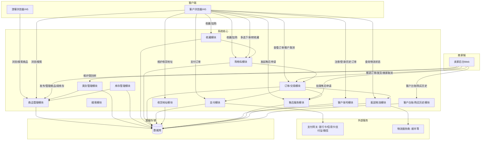
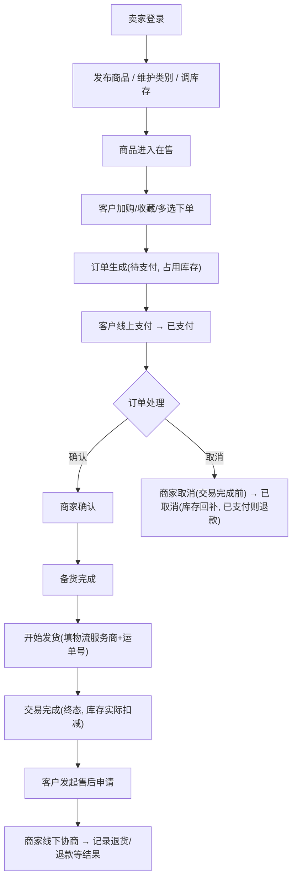
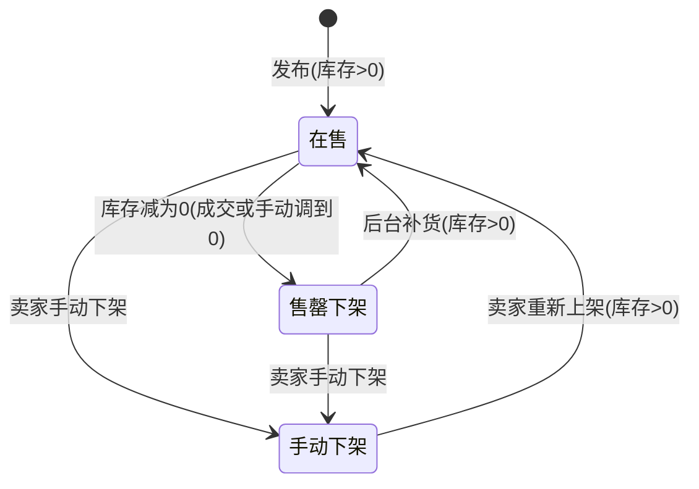
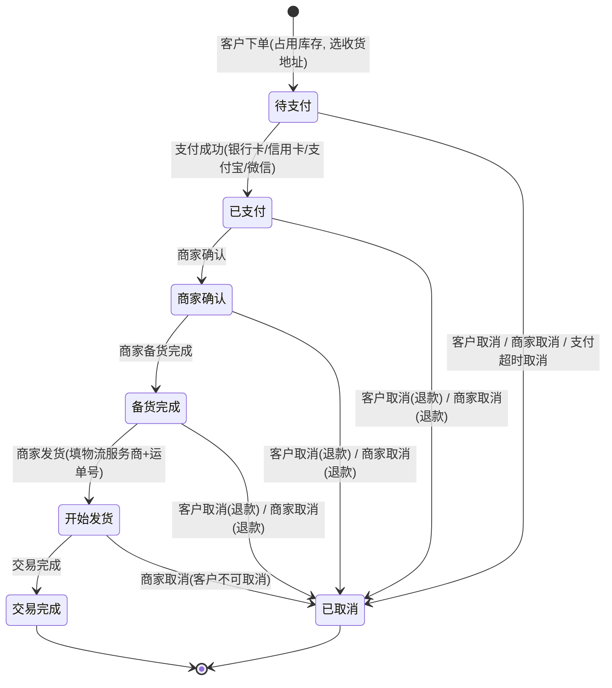
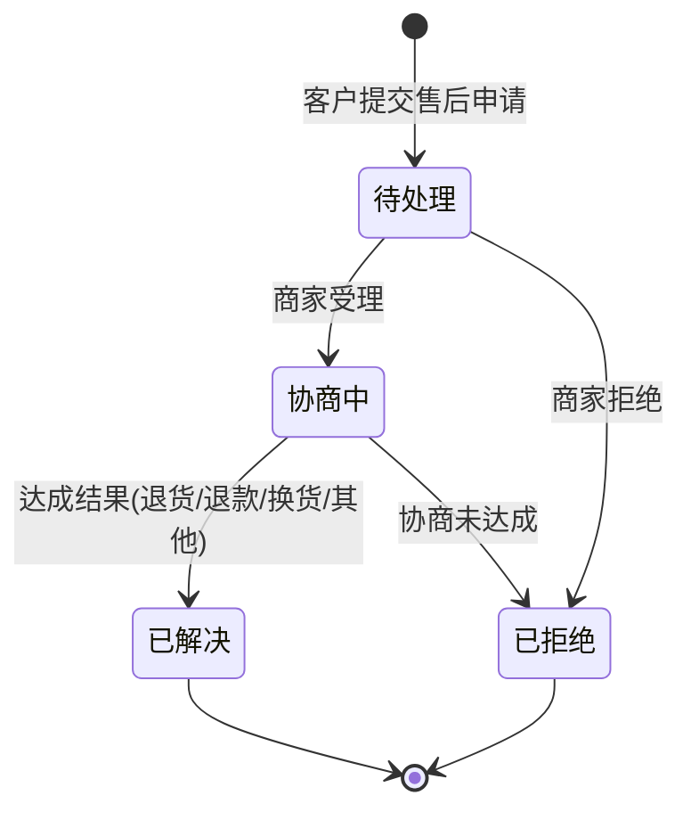
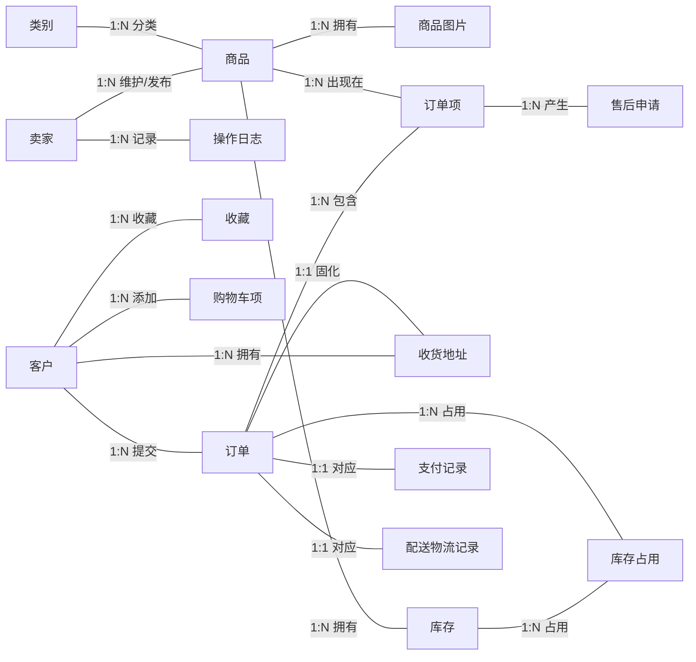

# 在线购物系统需求分析报告（挑战C升级版）

> **版本说明**：本版为挑战 C 定稿（C.1 支付升级逐项确认）。经需求评审确认，**挑战 C 全面落地，取代挑战 B 的「纯线下交易、无支付、无物流、无售后」模型**。
> 挑战 C 升级核心：
> - **C.1 支付升级**：订单线上支付（银行卡/信用卡 + 第三方支付宝/微信）；订单流程新增 **待支付、已支付** 两个状态；
> - **C.2 配送升级**：订单商品线下配送（顺丰等优质快递物流）；客户可维护**多个收货地址**并设**默认地址**；客户可查询**发货后的物流状态**；
> - **C.3 售后服务升级**：客户可对**某件商品**发起售后申请（标题、描述、图片）；商家线下与客户协商；售后结果含**退货、退款**等。
> 由此，订单生命周期升级为「**待支付 → 已支付 → 商家确认 → 备货完成 → 开始发货 → 交易完成**」，并新增配送物流与售后服务两条支线。

> ✅ **确认说明**：C.1 支付升级相关 14 项待确认项（TBD-01 ~ TBD-14）已与需求方逐项确认，本文档已按确认结论定稿，原 **【待定/TBD】** 标注全部落定（详见第 11 章「评审确认决议」）。


## 目录

1. [项目概述](#1-项目概述)
2. [用户角色分析](#2-用户角色分析)
3. [业务流程分析](#3-业务流程分析)
4. [功能需求](#4-功能需求)
5. [非功能需求](#5-非功能需求)
6. [数据需求](#6-数据需求)
7. [接口需求](#7-接口需求)
8. [约束与假设](#8-约束与假设)
9. [验收标准](#9-验收标准)
10. [风险分析](#10-风险分析)
11. [评审确认决议](#11-评审确认决议)
12. [需求变更清单](#12-需求变更清单)

---

## 1. 项目概述

### 1.1 项目背景

本系统是**单卖家 + 注册客户**模式的在线购物系统。卖家拥有唯一固定账号（无注册、无退出登录）。客户自由注册（用户名、密码（≥8位+强度要求）、电话、默认交易地点），**下单需登录**；未登录时的临时收藏/加购会在登录后自动合并进账号。游客可匿名浏览与搜索。

系统支持**同时发布多个商品**、**2 级类别**管理、**库存数量**控制（库存为 0 自动下架）、**多图片**与**富媒体**描述。客户通过**浏览或搜索**查找商品，可**收藏**、**加购物车**、从购物车**多选一键下单**（生成含多订单项的订单）或将**多选转收藏**。

相比挑战 B，挑战 C 打通了交易的「钱、货、售后」三环：

- **线上支付**：订单下单后进入「待支付」，客户可选用**银行卡、信用卡、支付宝、微信**完成线上支付，支付成功进入「已支付」；
- **配送物流**：商家发货时填写**物流服务商与运单号**，客户可查询**发货后的物流状态**；客户可维护**多个收货地址**并设**默认地址**；
- **售后服务**：客户可对订单内**某件商品**发起售后申请（标题、描述、图片），商家**线下协商**后记录**退货、退款**等结果。

### 1.2 系统架构概览



### 1.3 项目目标

- 卖家可同时发布并管理多个在售商品，维护类别树，手动补货/调整库存；
- 商品支持 2 级类别、库存控制、多图与富媒体描述；
- 客户可自由注册、登录、查看历史订单记录；浏览无需登录；未登录可临时收藏/加购（登录后自动合并）；下单必须登录；
- 客户可收藏商品、加入购物车、从购物车多选一键下单或多选转收藏；
- **订单线上支付**：下单进入「待支付」，支持银行卡、信用卡、支付宝、微信支付，支付成功进入「已支付」；
- **配送物流**：客户维护多个收货地址并设默认；商家发货填写物流服务商与运单号；客户可查询发货后的物流状态；
- **售后服务**：客户对订单内某件商品发起售后申请（标题、描述、图片），商家线下协商并记录退货、退款等结果；
- 订单具备完整生命周期：待支付 → 已支付 → 商家确认 → 备货完成 → 开始发货 → 交易完成，商家后台推进，客户侧只读；
- 支持双向取消：客户在「开始发货」前可取消，商家在「交易完成」前可取消；取消后回补库存（已支付则触发退款）；
- 商家可查看所有注册客户信息及其购买历史。

### 1.4 业务约束

- 系统用户分三类：卖家、游客、注册客户。
- 卖家只有一个账号，账号固定指定，无注册流程，后台无退出登录功能。
- 客户自由注册：用户名、密码（≥8位+强度要求）、电话、默认交易地点。
- 浏览、搜索、查看详情无需登录；未登录可临时收藏、加购，登录后自动恢复/合并；下单必须登录。
- 同一时间可同时存在多个在售商品。
- 商品支持 2 级类别管理；发布后不可编辑（仅库存可调）。
- 商品支持多张图片（最多 9 张，JPG/PNG，单张≤5MB，首图主图）、富媒体描述。
- 每个商品有库存（非负整数，最低 0）；库存为 0 自动下架；不允许超卖。
- 库存规则：提交下单即占用 → 取消逐件回补 → 交易完成核销扣减；可售数量 = 原始库存 − 已下单占用量。
- 客户可收藏、加购、购物车多选下单、购物车多选转收藏；收藏/购物车不锁库存。
- 下单必经购物车；下单成功后所选购物车项自动移除。
- **订单支付**：下单后订单进入「待支付」；客户可选用银行卡、信用卡、支付宝、微信进行线上支付，支付成功进入「已支付」。
- **订单状态**：待支付 → 已支付 → 商家确认 → 备货完成 → 开始发货 → 交易完成；由商家后台一步步推进，客户侧只读。
- **客户取消**：订单在「开始发货」前可取消；「开始发货」后不可取消。
- **商家取消**：订单在「交易完成」前可取消；「交易完成」后不可取消。
- 取消后订单标「已取消」，各商品占用库存回补；**已支付订单取消时触发退款**。
- **配送物流**：客户可维护多个收货地址，选择一个作为默认地址；下单时选择收货地址；商家发货时填写物流服务商与运单号；客户可查询发货后的物流状态。
- **售后服务**：客户可对订单内某件商品发起售后申请（标题、描述、图片）；商家线下协商；售后结果含退货、退款等。
- **无通知机制**（站内信/短信/推送均不提供），客户需主动查看订单、物流与售后状态。
- 商家的客户台账仅展示固定字段：用户名、电话、默认交易地点、注册时间及购买历史。

---

### 1.5 术语表

| 术语 | 含义 |
|---|---|
| 卖家 | 唯一的后台运营者，账号系统固定指定，无注册/退出；负责发布商品、调库存、维护类别、推进/取消订单、发货、处理售后 |
| 客户 | 自主注册的用户，可登录预选、下单、支付、收货、发起售后；有用户名、密码（≥8位+强度要求）、电话、默认交易地点 |
| 游客 | 未登录的访客，可浏览/搜索/看详情，可临时收藏/加购（登录后自动恢复合并）；下单必须登录 |
| 商品 | 卖家发布的可售物品，归属二级类别，含名称/描述/价格/库存/图片，发布后不可编辑（仅库存可调） |
| 二级类别 | 商品的必挂归属（小类），为 2 级树结构的叶子节点 |
| 在售 | 商品状态之一：可浏览/搜索/收藏/加购/下单，库存 > 0 |
| 收藏 | 客户对商品的喜好标记，不锁库存、不占位 |
| 购物车 | 客户预选容器，展示名称/单价/数量/小计；支持调数量、移除、多选下单、多选转收藏；不锁库存 |
| 占用库存 | 提交下单时对订单各订单项对应库存的占用；可售=原始−占用；取消回补、完成扣减 |
| 订单 | 客户从购物车选件下单生成的交易单位，含多个订单项，具生命周期 |
| 订单号 | 订单唯一业务编号，格式=日期+自增序号 |
| 订单项 | 订单中的一条商品明细（商品 + 数量 + 单价快照等） |
| **待支付** | 订单状态之一：客户下单生成订单后的初始态，等待客户完成线上支付 |
| **已支付** | 订单状态之一：客户线上支付成功后的状态，等待商家确认 |
| 商家确认 | 订单状态之一：商家接单确认 |
| 备货完成 | 订单状态之一：商家完成备货 |
| 开始发货 | 订单状态之一：商家发货（填写物流服务商与运单号），此后客户不可取消 |
| 交易完成 | 订单状态之一：交易完成，订单终态，库存实际扣减；此后商家不可取消 |
| 已取消 | 订单终态：客户取消或商家取消后的状态，占用库存回补（已支付则退款） |
| **线上支付** | 通过支付网关在线完成货款支付，支持银行卡、信用卡、支付宝、微信 |
| **第三方支付** | 通过支付宝、微信等第三方平台完成支付 |
| **支付流水/交易号** | 支付成功后由支付渠道返回的唯一交易凭证号 |
| **退款** | 已支付订单取消或售后退款时，将款项（原路）退回客户 |
| **收货地址** | 客户维护的收货信息（收货人、电话、省市区、详细地址等），可设默认 |
| **默认地址** | 客户标记的首选收货地址，下单时默认带出 |
| **物流服务商** | 承担配送的快递物流公司（如顺丰等优质快递） |
| **运单号** | 商家发货时填写的物流运单编号 |
| **物流状态** | 发货后包裹的运输轨迹状态（发货、运输中、派送、签收等） |
| **售后申请** | 客户对订单内某件商品发起的问题申请，含标题、描述、图片 |
| **售后结果** | 商家线下协商后记录的结论，如退货、退款等 |
| 默认交易地点 | 客户注册时填写的线下交易约定地点（档案字段，不随下单固化） |

---

## 2. 用户角色分析

### 2.1 角色定义

| 角色 | 是否有账号 | 账号来源 | 核心权限 | 说明 |
|---|---|---|---|---|
| 卖家 | 有，唯一账号 | 系统固定指定，无注册流程 | 登录后台、发布商品、维护类别树、调库存、查看订单、推进订单（确认/备货/发货/完成）、取消订单（交易完成前）、发货（填物流）、处理售后申请、查看客户台账与购买历史、修改密码 | 系统唯一后台使用者；无退出登录；商品发布后不可编辑（仅库存可调） |
| 客户 | 有，可注册 | 自由注册 | 注册/登录、浏览与搜索、收藏、加购、调整/移除购物车、多选下单、多选转收藏、**线上支付**、**维护收货地址**、**查询物流状态**、**发起售后申请**、查看订单、客户取消（开始发货前）、查看历史订单 | 浏览无需登录；下单必须登录；订单侧只读，不能推进状态 |
| 游客 | 无账号 | 无 | 匿名浏览、搜索、查看商品详情 | 可临时收藏、加购（登录后自动恢复）；下单必须登录 |

### 2.2 权限矩阵

| 功能 | 卖家 | 客户 | 游客 |
|---|---|---|---|
| 浏览商品 / 搜索 / 看详情 | 可 | 可 | 可 |
| 发布商品 | 可，可多个同时 | 不可 | 不可 |
| 编辑商品 | 不可（发布后定死） | 不可 | 不可 |
| 调整库存（补货） | 可 | 不可 | 不可 |
| 维护类别树 | 可（增删改） | 不可 | 不可 |
| 收藏商品 / 取消收藏 | 不可 | 可 | 可（临时） |
| 加入购物车 | 不可 | 可 | 可（临时） |
| 调整购物车（数量/移除） | 不可 | 可 | 可（临时） |
| 购物车多选下单 | 不可 | 可 | 不可（须登录） |
| 购物车多选转收藏 | 不可 | 可 | 可（临时） |
| **线上支付订单** | 不可 | 可 | 不可 |
| **维护收货地址 / 设默认** | 不可 | 可 | 不可 |
| **查询物流状态** | 可 | 可 | 不可 |
| **发起售后申请** | 不可 | 可 | 不可 |
| **处理售后申请** | 可 | 不可 | 不可 |
| 查看自己的订单 | 不可 | 可（只读） | 不可 |
| 客户取消订单（开始发货前） | 不可 | 可 | 不可 |
| 订单状态推进（确认/备货/发货/完成） | 可 | 不可 | 不可 |
| 商家取消订单（交易完成前） | 可 | 不可 | 不可 |
| 查看客户台账及购买历史 | 可（仅固定字段） | 不可（仅自己） | 不可 |
| 修改密码 | 可（卖家） | 可（客户） | 不可 |
| 退出登录 | 不需要 | 可 | 无账号 |

---

## 3. 业务流程分析

### 3.1 客户/游客主流程

```mermaid
flowchart TD
    A["游客浏览/搜索商品"] --> B{"操作"}
    B -->|收藏(未登录可临时)| D["加入我的收藏(不锁库存)"]
    B -->|加购物车(未登录可临时)| E["加入购物车"]
    B -->|下单未登录| C["引导注册/登录"]
    D --> E
    E --> F{"购物车操作"}
    F -->|多选转收藏| G["转为收藏并移出购物车"]
    F -->|调数量/移除| H["调整购物车"]
    F -->|选单件或多件下单| I["生成订单(占用库存), 选择收货地址"]
    I --> J["订单进入待支付"]
    J --> K["客户线上支付(银行卡/信用卡/支付宝/微信)"]
    K --> L["支付成功 → 已支付"]
    L --> M["订单沿 商家确认→备货→发货→完成 由商家推进"]
    M --> N["商家发货(填物流服务商+运单号)"]
    N --> O["客户查询物流状态"]
    O --> P["交易完成"]
    P --> Q["客户可对某件商品发起售后申请"]
    Q --> R["商家线下协商 → 记录退货/退款等结果"]
```

> **流程说明**：游客浏览搜索；预选（收藏/加购）未登录可临时进行，登录后自动合并；下单必须登录。登录后从购物车多选下单生成订单（占用库存、选择收货地址），进入「待支付」→ 客户线上支付成功进入「已支付」→ 商家按序推进并发货（填物流）→ 客户查物流 → 交易完成；交易完成后客户可对某件商品发起售后申请，商家线下协商并记录结果。

### 3.2 卖家主流程



> **流程说明**：卖家发布多商品并维护库存。客户购物车下单生成待支付订单并占用库存；客户支付成功后商家按「确认→备货→发货（填物流）→完成」单向推进；商家可在任一非终态阶段取消。交易完成后处理客户售后申请。

### 3.3 商品状态机



| 状态 | 说明 | 可流转到 |
|---|---|---|
| 草稿 | 已创建未发布，仅后台可见 | 在售 |
| 在售 | 可浏览/搜索/收藏/加购/下单；库存>0 | 售罄下架、手动下架 |
| 售罄下架 | 库存为 0 自动下架 | 在售（补货后恢复）、手动下架 |
| 手动下架 | 卖家主动撤下，退出在售 | 在售（重新上架且库存>0） |

> **说明**：挑战 C 不改变挑战 B 的商品状态机（草稿/在售/售罄下架/手动下架）；商品状态与支付/配送/售后无耦合。

### 3.4 订单状态机



> **推进机制**：订单状态由**商家后台一步步单向推进**；**客户侧只读**，仅能在「待支付」阶段完成支付，或在合法阶段取消。
> **取消规则：**
> - **客户取消**：仅在订单处于 **待支付 / 已支付 / 商家确认 / 备货完成**（尚未到「开始发货」）状态时可用；进入「开始发货」后客户不可取消。
> - **商家取消**：仅在订单处于 **「交易完成」之前**（待支付 / 已支付 / 商家确认 / 备货完成 / 开始发货）状态时可用；「交易完成」后商家不可取消。
> - 任何取消均将订单置为「已取消」，回补占用库存；**已支付订单取消时同步触发退款**。
> **支付与取消关系**：待支付订单取消无需退款；已支付及之后状态取消需退款。
> **超时自动取消**：待支付订单超 **24 小时** 未完成支付，由系统**自动取消**并回补占用库存（未支付，无需退款）；待支付阶段客户/商家手动取消依然可用。

| 状态 | 说明 | 可流转到 |
|---|---|---|
| **待支付** | 客户下单生成订单后的初始态，占用库存，等待客户线上支付 | 已支付、已取消 |
| **已支付** | 客户线上支付成功，等待商家处理 | 商家确认、已取消（退款） |
| 商家确认 | 商家接单确认 | 备货完成、已取消（退款） |
| 备货完成 | 商家已完成备货 | 开始发货、已取消（退款） |
| 开始发货 | 商家发货（填物流服务商+运单号），此后客户不可取消 | 交易完成、已取消（仅商家，退款） |
| 交易完成 | 订单终态，库存实际扣减，占用核销 | 终态（可发起售后申请） |
| 已取消 | 客户取消或商家取消产生的终态，占用库存回补（已支付则退款） | 终态 |

### 3.5 库存与预选规则

| 项目 | 规则 |
|---|---|
| 占用时机 | 提交下单那一刻占用（真扣减）；购物车/收藏不占用 |
| 可售语义 | 可售数量 = 原始库存 − 已下单占用量；占用即锁死可售 |
| 回补时机 | 订单取消时逐件回补（每件 +1） |
| 扣减时机 | 订单交易完成时实际扣减、占用核销 |
| 库存语义 | 非负整数，最低 0，不允许负库存 |
| 不足判断 | 下单时逐商品校验：不足单项提示缺货、不可下单 |
| 库存为 0 | 商品自动下架（售罄下架） |
| 待支付订单与库存 | **下单即占用**：待支付订单同样占用库存（与 B 一致，非支付成功才占用）；取消（含超时自动取消）时回补库存 |
| 退货与库存 | **退货成功回补库存**；纯退款（不退换货、商品未退回）不回补库存 |

### 3.6 订单状态可见性（客户只读）

| 场景 | 客户看到 | 能否操作 |
|---|---|---|
| 待支付 | 订单号、商品清单、总金额、收货地址、支付方式选择 | 可**支付**；可取消 |
| 已支付 / 商家确认 / 备货完成 | 订单号、商品清单、总金额、收货地址、支付状态 | 可取消（开始发货前） |
| 开始发货 | 订单信息 + **物流服务商/运单号 + 物流状态** | 不可取消；可查物流 |
| 交易完成 | 订单信息 + 支付/物流状态 | 不可取消；可发起售后申请 |
| 已取消 | 订单号、取消原因标记、退款状态（如已支付） | 只读 |

### 3.7 配送物流规则

| 项目 | 规则 |
|---|---|
| 收货地址 | 客户可维护多个收货地址，字段含收货人、电话、省市区、详细地址（邮编选填） |
| 默认地址 | 客户可设置一个默认地址；下单时默认带出，可临时改选其他地址 |
| 下单选地址 | 下单时必须选择收货地址（默认带出、可改选其他已有地址）；**不可当场新建/编辑**，地址维护（增删改、设默认）在「地址管理」完成 |
| 地址固化 | 下单时订单固化收货地址快照，后续修改地址不影响已下单订单 |
| 发货 | 商家在「开始发货」时填写物流服务商（顺丰等）与运单号 |
| 物流查询 | 客户可查询发货后的物流状态（物流服务商 + 运单号 + 跟踪信息）；**由商家手动更新**（发货/运输中/派送/签收），不强制对接物流 API |
| 运费 | **本期不含运费**：订单总金额 = 商品小计；配送费用线下协商、不计入系统 |

### 3.8 售后规则

| 项目 | 规则 |
|---|---|
| 发起对象 | 客户对**订单内某件商品（订单项）**发起售后申请 |
| 申请单内容 | 标题、描述、图片；图片沿用商品图片规则（最多 9 张，JPG/PNG，单张≤5MB）；申请单**无「类型」字段** |
| 售后类型 | 申请时不选择类型；**退货、退款、换货等为商家线下协商后记录的结果** |
| 协商方式 | 商家收到申请后**线下**与客户协商 |
| 结果记录 | 商家在系统内记录售后结果（退货、退款、换货等） |
| 售后与订单 | 售后针对订单项，不改变整单状态；售后流程为「客户申请 → 商家线下协商 → 出结果」；系统的「待处理/协商中/已解决/已拒绝」为内部追溯状态（需求未定义正式状态机） |
| 退款关联 | 售后退款与 C.1 取消退款**统一同一退款通道（原路退回）**；售后退款由商家处理售后时触发 |

### 3.9 售后申请状态机



| 状态 | 说明 | 可流转到 |
|---|---|---|
| 待处理 | 客户提交售后申请后的初始态 | 协商中、已拒绝 |
| 协商中 | 商家受理，线下协商进行中 | 已解决、已拒绝 |
| 已解决 | 达成售后结果（退货、退款、换货等） | 终态 |
| 已拒绝 | 商家拒绝或协商未达成 | 终态 |

> **说明**：需求未定义售后的正式状态机，真实流程为「客户申请 → 商家线下协商 → 出结果（退货/退款/换货）」。上表状态为本系统为流程可追溯而归纳的内部状态（非需求写死），供实现参考。

---

## 4. 功能需求

> 📌 标注：【增】为挑战 C 新增，【改】为在挑战 B 基础上改造，【废】为挑战 C 作废项（列表内不再出现）。

### 4.1 商品管理

| 编号 | 需求 | 角色 | 说明 | 验收标准 |
|---|---|---|---|---|
| FR-001 | 多商品同时在售【改】 | 卖家 | 可同时发布多个商品，不受数量限制 | 多件商品可同时上架并可各自售卖 |
| FR-002 | 发布商品【改】 | 卖家 | 填名称、描述、价格、库存、类别、多图片 | 保存后客户可见 |
| FR-003 | 2级类别【改】 | 卖家 | 商品归属大类>小类两级，必须挂二级 | 商品必挂小类 |
| FR-004 | 类别树维护【改】 | 卖家 | 类别仅新增/重命名/删除，无移动 | 有商品的类别禁止删除 |
| FR-005 | 库存数量【改】 | 卖家/系统 | 每商品库存（非负整数）；库存为0自动下架 | 库存为0自动下架 |
| FR-006 | 手动补货/调库存【改】 | 卖家 | 后台调整库存（可增可减，下限0） | 调整>0后恢复在售 |
| FR-007 | 商品不可编辑【改】 | 系统 | 发布后名称/描述/图片/价格/类别均不可改 | 后台无编辑入口 |
| FR-008 | 多图商品【改】 | 卖家/系统 | 最多9张，JPG/PNG，单张≤5MB；首图主图 | 可上传并展示多图 |
| FR-009 | 富媒体描述【改】 | 卖家/系统 | 富文本内嵌图片与视频，本地上传 | 描述可含富媒体 |
| FR-010 | 搜索商品【改】 | 客户/游客 | 按关键词/名称/类别检索 | 可搜到匹配商品 |
| FR-011 | 商品下架【改】 | 卖家 | 手动下架/售罄自动下架 | 下架后不可收藏/加购/下单 |

### 4.2 库存与预选

| 编号 | 需求 | 角色 | 说明 | 验收标准 |
|---|---|---|---|---|
| FR-012 | 下单占用库存【增】 | 系统 | 提交下单即占用（真扣减） | 占用后该数量不可再被下单 |
| FR-013 | 取消回补库存【增】 | 系统 | 订单取消时逐件回补占用 | 取消后对应库存恢复可售 |
| FR-014 | 完成扣减库存【改】 | 系统 | 交易完成时实际扣减、占用核销 | 完成订单后库存扣减 |
| FR-015 | 库存0自动下架【改】 | 系统 | 库存为0自动下架 | 库存0时不再接受下单 |
| FR-016 | 补货恢复【改】 | 卖家 | 库存调整>0后恢复在售 | 补货后可再购买 |
| FR-017 | 非负库存【改】 | 系统 | 库存非负整数最低0 | 不允许负库存 |
| FR-018 | 收藏商品【增】 | 客户 | 收藏在售商品；可取消收藏 | 收藏列表可见；可移除 |
| FR-019 | 收藏项下架处置【增】 | 系统 | 商品下架后收藏项保留并标注 | 收藏列表项带下架标记 |
| FR-020 | 加入购物车【增】 | 客户 | 同商品唯一，可调数量 | 购物车可见 |
| FR-021 | 调整/移除购物车【增】 | 客户 | 调数量或移除购物车项 | 修改即时生效 |

### 4.3 下单与订单

| 编号 | 需求 | 角色 | 说明 | 验收标准 |
|---|---|---|---|---|
| FR-022 | 预选暂存与下单登录【改】 | 客户端 | 未登录可临时收藏/加购，登录后合并；下单须登录 | 未登录加购/收藏登录后不丢失 |
| FR-023 | 购物车多选下单【改】 | 客户 | 从购物车选单件或多件下单；逐商品校验库存；下单后所选项移除 | 生成含多订单项订单并占用库存 |
| FR-024 | 购物车多选转收藏【增】 | 客户 | 从购物车多选转收藏 | 收藏列表新增，原购物车项移除 |
| FR-025 | 生成订单（待支付）【改】 | 系统 | 下单生成订单，初始态改为「待支付」，含多订单项 | 订单生成并进入状态机 |
| FR-026 | 订单状态推进【改】 | 卖家 | 依序：已支付→商家确认→备货完成→开始发货→交易完成 | 单向推进，不可跳序、不可回退 |
| FR-027 | 订单只读【增】 | 客户 | 客户仅可查看订单状态，不可推进 | 无推进入口 |
| FR-028 | 客户取消订单【改】 | 客户 | 开始发货前可取消，置已取消并回补库存（已支付则退款） | 取消成功；开始发货后无入口 |
| FR-029 | 商家取消订单【改】 | 卖家 | 交易完成前可取消，置已取消并回补库存（已支付则退款） | 完成后无入口 |
| FR-030 | 订单查询/历史【改】 | 客户 | 查看订单及历史；记录含订单号、商品清单、总金额、支付状态、物流状态、下单时间、订单状态/结果 | 列表按上述字段展示 |
| FR-031 | 商家订单管理【改】 | 卖家 | 订单列表/按状态筛选/推进/取消/发货 | 可完整管理订单生命周期 |

### 4.4 台账与后台

| 编号 | 需求 | 角色 | 说明 | 验收标准 |
|---|---|---|---|---|
| FR-032 | 商家客户台账【改】 | 卖家 | 查看注册客户，固定字段：用户名/电话/默认交易地点/注册时间 | 仅固定字段 |
| FR-033 | 商家购买/订单历史【改】 | 卖家 | 查看客户订单历史 | 可追溯客户历次订单 |
| FR-034 | 卖家登录【改】 | 卖家 | 固定账号+用户名密码 | 成功/失败有提示 |
| FR-035 | 无注册/无退出【改】 | 系统 | 单一固定账号 | 无相关入口 |
| FR-036 | 修改密码【改】 | 卖家 | 校验旧密码，新密码≥8位+强度要求 | 修改成功 |
| FR-037 | 操作日志【改】 | 系统 | 记录卖家关键操作 | 日志可查 |
| FR-038 | 终端与过程【改】 | 全 | 卖家后台Web、买家Web/H5、Scrum过程 | 各核心功能可用 |

### 4.5 支付管理【增】

| 编号 | 需求 | 角色 | 说明 | 验收标准 |
|---|---|---|---|---|
| FR-039 | 线上支付【增】 | 客户 | 订单待支付时发起线上支付，支持银行卡、信用卡、支付宝、微信（**本期为模拟/预留接口**，真实对接另立项） | 支付成功订单进入已支付 |
| FR-040 | 支付方式选择【增】 | 客户 | 下单/待支付时选择支付方式（银行卡/信用卡/支付宝/微信） | 可选择并完成对应渠道支付 |
| FR-041 | 支付成功【增】 | 系统 | 支付回调成功后将订单置「已支付」，记录支付流水/交易号与支付时间 | 支付成功状态同步 |
| FR-042 | 支付失败【增】 | 系统 | 支付失败订单保持「待支付」，允许重新发起支付 | 失败不改变订单状态 |
| FR-043 | 支付超时处理【增】 | 系统 | 待支付订单超 24 小时未支付，系统自动取消订单并回补占用库存 | 超 24 小时自动取消并回补库存 |
| FR-044 | 取消退款【增】 | 系统 | 已支付订单取消时触发退款（原路退回） | 退款成功并记录退款流水 |
| FR-045 | 退款记录【增】 | 系统 | 记录退款流水、退款时间、退款状态 | 退款可追溯 |

### 4.6 收货地址与配送【增】

| 编号 | 需求 | 角色 | 说明 | 验收标准 |
|---|---|---|---|---|
| FR-046 | 收货地址管理【增】 | 客户 | 新增/编辑/删除多个收货地址 | 地址可增删改 |
| FR-047 | 默认地址【增】 | 客户 | 可设置一个地址为默认 | 下单时默认带出该地址 |
| FR-048 | 下单选择地址【增】 | 客户 | 下单时选择收货地址（默认带出，可改选） | 订单固化所选地址 |
| FR-049 | 发货填物流【增】 | 卖家 | 开始发货时填写物流服务商（顺丰等）与运单号 | 发货后订单带物流信息 |
| FR-050 | 物流状态查询【增】 | 客户 | 客户可查询发货后的物流状态 | 展示物流轨迹/状态 |

### 4.7 售后服务【增】

| 编号 | 需求 | 角色 | 说明 | 验收标准 |
|---|---|---|---|---|
| FR-051 | 发起售后申请【增】 | 客户 | 对订单内某件商品发起售后申请，提交标题、描述、图片 | 申请单生成 |
| FR-052 | 售后申请单内容【增】 | 客户 | 申请单含标题、描述、图片（最多 9 张，JPG/PNG，单张≤5MB），**无「类型」字段** | 字段完整可提交 |
| FR-053 | 商家处理售后【增】 | 卖家 | 收到申请后线下与客户协商，并记录售后结果（退货、退款、换货等） | 售后结果可记录 |
| FR-054 | 售后结果【增】 | 系统 | 售后结果含退货、退款、换货等（提交申请时不选类型、协商后定），客户可查看 | 结果可见并留痕 |
| FR-055 | 售后状态流转【增】 | 系统 | 售后申请内部状态流转（待处理/协商中/已解决/已拒绝），需求未写死、用于流程可追溯 | 状态可追溯 |

---

## 5. 非功能需求

| 编号 | 类别 | 需求 |
|---|---|---|
| NFR-001 | 性能 | 商品列表/详情/搜索响应小于 2 秒 |
| NFR-002 | 安全 | 密码哈希存储，HTTPS，防 CSRF、XSS、SQL 注入 |
| NFR-003 | 账号安全 | 密码哈希存储；密码规则：≥8位+强度要求（大写+小写+数字+特殊字符至少3类）；无找回密码 |
| NFR-004 | 数据隐私 | 客户信息（电话、收货地址、交易地点）受保护，仅授权范围可见 |
| NFR-005 | 库存一致性 | 下单占用、取消回补、完成扣减需事务保证一致，防止超卖/泄漏 |
| NFR-006 | 订单一致性 | 订单状态单向状态机，并发操作需事务+行锁 |
| NFR-007 | 可用性 | 系统可用性不低于 99% |
| NFR-008 | 兼容性 | 支持主流浏览器；移动端适配以最终终端范围为准 |
| NFR-009 | 可维护性 | 模块化、接口文档、日志规范 |
| NFR-010 | 审计 | 卖家关键操作可追溯，订单/库存/支付/售后变更完整记录 |
| NFR-011 | 备份 | 数据库定期备份可恢复 |
| NFR-012 | 上传 | 图片/富媒体/售后图片上传校验类型与大小，防恶意上传 |
| NFR-013 | **支付安全【增】** | 支付敏感信息加密传输、支付回调验签、防伪造回调、幂等处理（防重复支付/重复退款）、合规（PCI 相关） |
| NFR-014 | **支付一致性【增】** | 支付状态与订单状态同步需幂等+事务，避免重复扣款/漏记账 |
| NFR-015 | **物流一致性【增】** | 物流状态与运单号记录准确、可追溯 |
| NFR-016 | **售后一致性【增】** | 售后结果与退款/退货联动需保证一致，退款金额与订单金额对账 |

---

## 6. 数据需求

### 6.1 实体关系图



### 6.2 主要实体

| 实体 | 说明 |
|---|---|
| 卖家 | 唯一固定账号，系统初始化写入，无注册无退出 |
| 客户 | 注册客户：用户名、密码哈希、电话、默认交易地点 |
| 类别 | 2 级树结构，支持增删改 |
| 商品 | 名称、富媒体描述、价格、类别、状态；多图；发布后不可编辑 |
| 商品图片 | 多张，带排序 |
| 库存 | 每商品库存数；下单占用、取消回补、完成扣减 |
| 库存占用 | 订单对商品库存的占用记录 |
| 收藏 | 客户对商品的喜好标记 |
| 购物车项 | 客户购物车条目 |
| **收货地址【增】** | 客户维护的收货信息：收货人、电话、省市区、详细地址、是否默认 |
| 订单 | 含多订单项；7 态：待支付/已支付/商家确认/备货完成/开始发货/交易完成/已取消；固化收货地址 |
| 订单项 | 订单中的商品明细（订单ID、商品ID、数量、单价快照） |
| **支付记录【增】** | 支付流水/交易号、支付方式、支付金额、支付状态、支付时间 |
| **退款记录【增】** | 退款流水、退款金额、退款状态、退款时间 |
| **配送物流记录【增】** | 物流服务商、运单号、物流状态、发货时间 |
| **售后申请【增】** | 订单项ID、标题、描述、图片、状态、结果（退货/退款/换货等；申请单无「类型」字段） |
| 客户台账/历史 | 商家可查客户信息及其订单历史 |
| 操作日志 | 卖家关键操作留痕 |

---

## 7. 接口需求

| 接口类型 | 说明 |
|---|---|
| 公开接口 | 商品列表、商品详情、搜索、类别浏览；游客可用 |
| 客户接口 | 注册、登录、个人信息、收藏/取消收藏、加购/调数量/移除、多选下单、多选转收藏、订单查询、客户取消、历史订单、**发起支付、支付回调、收货地址管理、物流查询、发起售后申请、查看售后状态** |
| 卖家接口 | 登录、发布商品、类别管理、库存调整、订单列表/筛选、推进订单、发货（填物流）、取消订单、售后处理、客户台账、购买历史、修改密码 |
| 支付接口 | **支付下单、支付回调、支付查询、退款、退款回调**（对接支付网关） |
| 物流接口 | **物流记录/查询**（本期物流状态由商家手动更新；如需对接物流服务商 API 实时跟踪，另立项评估） |
| 文件接口 | 商品多图、富媒体上传、售后申请图片上传 |

---

## 8. 约束与假设

1. 系统用户三类：卖家、客户、游客。
2. 卖家只有一个固定账号，无注册流程，后台无退出登录。
3. 客户自由注册（用户名、密码、电话、默认交易地点）。
4. 浏览、搜索、查看详情无需登录；未登录可临时收藏、加购，登录后自动恢复合并；下单必须登录。
5. 同一时间可同时存在多个在售商品。
6. 商品支持 2 级类别，必须归属二级；类别仅新增/重命名/删除。
7. 商品发布后不可编辑（名称、描述、图片、价格、类别定死）；唯一可动字段为库存数量。
8. 商品支持最多9张图（JPG/PNG，单张≤5MB，首图主图）、富媒体描述（本地上传）。
9. 每个商品有库存（非负整数，最低0）；提交下单即占用、取消逐件回补、完成扣减；库存为0自动下架。
10. 客户可收藏、加购、购物车多选下单、多选转收藏；收藏/购物车均不锁库存。
11. 同一客户对同一商品在购物车中仅一条、收藏中仅一条。
12. 订单 7 态：待支付→已支付→商家确认→备货完成→开始发货→交易完成（+已取消）；单向推进、不可跳序、不可回退；客户侧只读。
13. 客户取消：订单在「开始发货」前可取消；「开始发货」后不可。
14. 商家取消：订单在「交易完成」前可取消；「交易完成」后不可。
15. 取消后订单标「已取消」，占用库存回补；已支付订单取消时触发退款。
16. **线上支付**：支持银行卡、信用卡、支付宝、微信；下单后进入「待支付」，支付成功进入「已支付」；**本期为模拟/预留接口**（真实对接需渠道资质、密钥，另立项）。
17. **配送物流**：客户维护多个收货地址（收货人、电话、省市区、详细地址，邮编选填）并设默认；下单选地址（默认带出、可切换，**不可当场新建/编辑**）；商家发货填物流服务商与运单号；客户可查物流状态（**商家手动更新**，不强制对接物流 API）。
18. **售后服务**：客户对订单内某件商品发起售后申请（标题、描述、图片；图片沿用商品图片规则）；申请单**无「类型」字段**，退货/退款/换货为商家线下协商后记录的结果；**退货成功回补库存，纯退款不回补**。
19. 商家客户台账仅展示固定字段：用户名、电话、默认交易地点、注册时间及购买历史。
20. 无通知机制；客户需主动查看订单、物流、售后状态。
21. 挑战 B 遗留的「线下交易、无支付、无物流」口径在挑战 C 中被线上支付与配送取代；「开始发货/交易完成」的语义由「线下标记」升级为「发货（填物流）/交易完成」。
22. 下单必经购物车；无详情页"立即购买"旁路。
23. 订单历史记录含：订单号、商品清单、总金额、支付状态、物流状态、收货地址、下单时间、订单状态/结果。
24. **待支付超时**：待支付订单超 24 小时未支付，系统自动取消并回补库存（未支付无需退款）。
25. **本期不含运费**：订单总金额 = 商品小计；配送费用线下协商、不计入系统。
26. 售后退款与取消退款统一走**同一退款通道（原路退回）**；售后退款由商家处理售后时触发。

---

## 9. 验收标准

| 编号 | 验收项 | 标准 |
|---|---|---|
| AC-001 | 多商品同时在售 | 可同时上架多个商品并各自售卖 |
| AC-002 | 2级类别 | 商品必须归属二级类别，可浏览/筛选 |
| AC-003 | 库存控制 | 库存0自动下架，补货>0恢复；不允许负库存 |
| AC-004 | 多图/富媒体 | 商品支持多图与富媒体 |
| AC-005 | 浏览与搜索 | 游客/客户可浏览、搜索、看详情 |
| AC-006 | 客户注册 | 用户名/密码/电话/默认交易地点注册成功 |
| AC-007 | 预选暂存与下单登录 | 未登录可临时收藏/加购，登录后恢复合并 |
| AC-008 | 收藏 | 客户收藏/取消收藏；不锁库存 |
| AC-009 | 收藏下架处置 | 下架后收藏项保留并标注 |
| AC-010 | 加入购物车 | 展示名称/单价/数量/小计；可调数量/移除 |
| AC-011 | 购物车多选下单 | 生成含多订单项订单并占用库存 |
| AC-012 | 购物车多选转收藏 | 多选转收藏，原购物车项移除 |
| AC-013 | 订单生命周期 | 待支付→已支付→商家确认→备货完成→开始发货→交易完成 单向推进；客户只读 |
| AC-014 | 客户取消 | 开始发货前客户可取消 |
| AC-015 | 商家取消 | 交易完成前商家可取消 |
| AC-016 | 取消回补库存 | 取消后订单标已取消，占用库存回补 |
| AC-017 | 库存占用/扣减 | 下单占用防超卖；完成扣减、占用核销 |
| AC-018 | 客户订单历史 | 含订单号、商品清单、总金额、支付/物流状态、下单时间、状态/结果 |
| AC-019 | 商家客户台账 | 商家仅可查看固定字段及购买历史 |
| AC-020 | **线上支付【增】** | 待支付订单支持银行卡/信用卡/支付宝/微信支付，成功进入已支付 |
| AC-021 | **支付状态【增】** | 待支付、已支付两状态正确流转；支付失败保持待支付可重试；**超 24 小时未支付自动取消并回补库存** |
| AC-022 | **取消退款【增】** | 已支付订单取消时触发退款并记录退款流水 |
| AC-023 | **收货地址【增】** | 客户可增删改多个地址，可设默认，下单默认带出 |
| AC-024 | **发货物流【增】** | 商家发货填物流服务商与运单号 |
| AC-025 | **物流查询【增】** | 客户可查询发货后的物流状态 |
| AC-026 | **售后申请【增】** | 客户对某件商品发起售后申请（标题、描述、图片） |
| AC-027 | **售后结果【增】** | 商家线下协商后记录退货、退款等结果，客户可查看 |

---

## 10. 风险分析

| 风险 | 影响 | 应对 |
|---|---|---|
| 库存占用与并发 | 超卖或占用泄漏 | 占用/回补/扣减用事务+行锁保证原子性 |
| 多订单并发 | 状态错乱、重复取消 | 订单状态单向校验+行锁 |
| 取消与商家推进竞态 | 取消/推进冲突 | 状态机校验+行锁 |
| **支付回调与状态同步** | 重复扣款、漏记账、回调伪造 | 幂等+验签+事务；支付与订单状态对账 |
| **支付与取消竞态** | 支付中同时取消，退款错乱 | 支付/退款状态机+幂等+行锁 |
| **超时自动取消竞态** | 超时自动取消与支付中/手动取消并发冲突 | 超时任务用行锁+状态机校验，幂等处理 |
| **退款一致性** | 重复退款、金额错乱 | 退款幂等、原路退回、金额对账 |
| **物流信息不准** | 客户查不到/查错物流 | 运单号校验、物流状态可靠来源 |
| **售后退款联动** | 退款与退货库存错乱 | 售后结果与退款/库存联动用事务保证 |
| 客户数据隐私 | 合规风险 | 地址/电话等最小化收集，权限分级，日志审计 |
| 富媒体/多图/售后图片上传 | XSS/恶意文件 | 类型大小校验、富媒体净化 |
| 下架后收藏/购物车项 | 失效项误导 | 收藏标注下架、购物车项失效提示 |
| 多选下单部分项缺货 | 缺货单项被误伤 | 下单前逐商品校验 |
| 单卖家账号 | 无法多卖家扩展 | 明确单卖家模式 |

---

## 11. 评审确认决议

> 原 TBD-01 ~ TBD-14 已与需求方逐项确认，结论如下（本文档已按此口径落定）。

| 编号 | 确认项 | 确认结论（定稿口径） |
|---|---|---|
| TBD-01 | 待支付订单是否占用库存 | **占用**。下单即占用库存（与挑战 B 一致），取消才回补；不采用「支付成功才占用」 |
| TBD-02 | 支付超时自动取消 | **24 小时超时自动取消**。待支付超 24 小时未付，系统自动取消并回补库存（未支付无需退款），见 FR-043 |
| TBD-03 | 支付方式真实对接还是模拟 | **本期模拟/预留接口**（真实对接支付宝/微信/银联需渠道资质与密钥，建议另立项） |
| TBD-04 | 已支付后取消的退款渠道 | **原路退回**：银行卡、信用卡、支付宝、微信各自退回原支付渠道 |
| TBD-05 | 退款发起方与时机 | **已支付订单取消即自动触发退款**，无需商家手动发起；售后退款单独走售后流程、由商家处理售后时触发 |
| TBD-06 | 运费 | **本期不含运费**：订单总金额 = 商品小计；配送费用线下协商、不计入系统 |
| TBD-07 | 下单时能否当场新建/编辑地址 | **下单仅可选择已有地址**（默认带出、可切换改选）；新增/编辑到「地址管理」完成 |
| TBD-08 | 收货地址字段 | **收货人、电话、省市区、详细地址**（邮编选填） |
| TBD-09 | 物流状态来源 | **商家手动更新**（发货/运输中/派送/签收），展示物流服务商 + 运单号 + 跟踪信息；对接顺丰等物流 API 实时跟踪属技术实现、不强制 |
| TBD-10 | 售后图片限制 | **沿用商品图片规则**：最多 9 张 / JPG·PNG / 单张≤5MB |
| TBD-11 | 售后类型选择时机 | **修正**：售后申请单仅含标题、描述、图片，**无「类型」字段**；退货/退款/换货为商家线下协商后记录的结果，提交时不选类型 |
| TBD-12 | 退货是否回补库存 | **退货成功回补库存**；纯退款（不退换货、商品未退回）不回补 |
| TBD-13 | 售后状态机 | **需求未定义正式状态机**，流程为「客户申请 → 商家线下协商 → 出结果（退货/退款/换货）」；「待处理→协商中→已解决/已拒绝」为本系统内部可追溯状态，非需求写死 |
| TBD-14 | 售后退款与 C.1 退款关系 | **统一同一退款通道（原路退回）**：取消退款与售后退款同通道；售后退款由商家处理售后时触发 |

---

## 12. 需求变更清单

> 对比基准：挑战 B 口径。按 新增/修改/废弃 三类列出。

### 12.1 新增需求

| 编号 | 新增内容 | 说明 | 关联 |
|---|---|---|---|
| X-01 | **订单线上支付** | 银行卡/信用卡/支付宝/微信支付 | FR-039~041、AC-020 |
| X-02 | **待支付/已支付状态** | 订单流程新增 2 状态 | FR-025、AC-013/021 |
| X-03 | **取消退款** | 已支付订单取消触发退款 | FR-044/045、AC-022 |
| X-04 | **收货地址管理** | 多地址 + 默认地址 | FR-046~048、AC-023 |
| X-05 | **配送物流** | 发货填物流 + 物流查询 | FR-049/050、AC-024/025 |
| X-06 | **售后服务** | 售后申请 + 线下协商 + 结果记录 | FR-051~055、AC-026/027 |
| X-07 | **新增数据实体** | 收货地址、支付记录、退款记录、配送物流记录、售后申请 | 6.1/6.2 |
| X-15 | **支付超时自动取消** | 待支付订单超 24 小时未支付自动取消并回补库存 | FR-043、AC-021 |
| X-16 | **售后类型口径** | 售后申请单无「类型」字段，退货/退款/换货为协商后记录的结果 | FR-052~054 |

### 12.2 修改需求

| 编号 | 修改内容 | 说明 |
|---|---|---|
| X-08 | **订单初始态改造** | 由「客户下单」改为「待支付」，新增「已支付」 |
| X-09 | **订单状态机改造** | 5 态 + 已取消 → 7 态 + 已取消（待支付/已支付/确认/备货/发货/完成） |
| X-10 | **取消规则扩展** | 取消时已支付订单同步退款 |
| X-11 | **发货语义升级** | 「开始发货」由线下标记升级为「填写物流服务商+运单号」 |
| X-12 | **订单历史字段扩展** | 新增支付状态、物流状态、收货地址 |

### 12.3 废弃需求

| 编号 | 废弃内容 | 说明 |
|---|---|---|
| X-13 | **「默认线下交易、无支付无物流」** | 挑战 B 的线下交易口径被线上支付与配送取代 |
| X-14 | **「线下标记发货/完成」** | 「开始发货」升级为真实发货（填物流），「交易完成」语义保留商家单方标记 |

---

## 附：挑战 C 确认要点（需求方）

- **C.1 支付升级**：订单线上支付；支持银行卡、信用卡、支付宝、微信；订单新增「待支付、已支付」2 态。
- **C.2 配送升级**：订单商品线下配送；支持顺丰等优质快递；客户多收货地址+默认地址；客户可查发货后物流状态。
- **C.3 售后服务升级**：客户对某件商品发起售后申请；申请单含标题、描述、图片；商家线下协商；结果含退货、退款等。

### 附：待确认决议（已确认）

> TBD-01 ~ TBD-14 已全部确认，逐项结论见第 11 章「评审确认决议」。C.1 支付升级核心口径速览：
> - **下单即占用库存**，待支付订单同样锁库存；待支付超 **24 小时** 自动取消并回补库存；
> - 本期支付为**模拟/预留接口**；已支付订单取消**自动触发退款、原路退回**（各支付渠道退回原渠道）；
> - **本期不含运费**（订单总金额 = 商品小计）；下单仅可选已有地址（增改到「地址管理」）；物流状态由**商家手动更新**；
> - 售后申请单仅**标题、描述、图片**（图片沿用商品图片规则：9 张 / JPG·PNG / 单张≤5MB），**无「类型」字段**；退货/退款/换货为**协商后记录的结果**；退货成功回补库存、纯退款不回补；售后退款与取消退款**同一原路退回通道**。